# Creatures

<!-- Generated by `pnpm docs:content` (tools/docs) from the content files. Do not edit by hand. -->

55 creatures in 23 evolution lines: 3 starter lines and 20 wild lines (roster v2, D167). Rarity decides how often a creature appears; the spawn tables follow it (`packages/data/content/spawns.json`).

**Spawn chance** is the share of all wild creatures (no field ability needed) that are this species, computed exactly from the spawn rules over the whole region, day and night counted half each. **Destinations** are real nature (forest, park, meadow, field or water) in the forest, field and lake zones on the Town Map: spawns there are about 2.3 times as dense as in streets and rare creatures 3 times as likely (D167). Common and uncommon creatures appear at the player's own level; rare and very rare ones at their district's level and only once their zone is open.

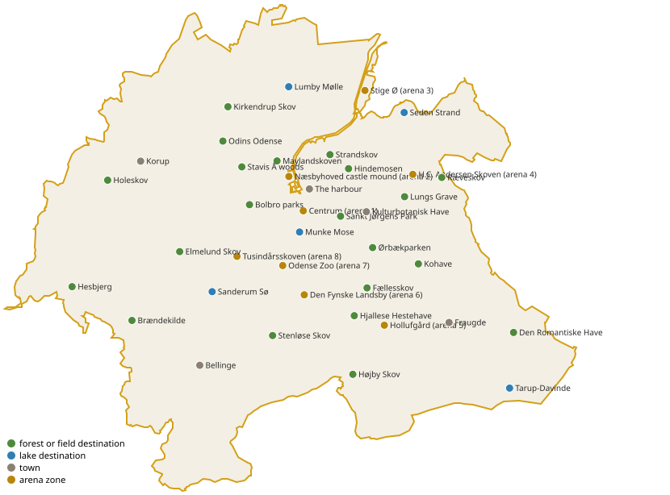

## Wild lines

| # | Line (evolves at level) | Types | Rarity | Spawn chance in destinations | Spawn chance elsewhere | Where | Map |
|---|---|---|---|---|---|---|---|
| 1 | Torvdue → Kirkedue (18) → Vinddue (36) | folk | Common | 10.1 % | 20.1 % | districts 1, 2, 3, 4, 5, 6, 7, 8; likes urban, park, historic. Most in: Bellinge 8 %, Kirkendrup Skov 6 %, Lumby Mølle 6 % | [map](creatures/torvdue.svg) |
| 2 | Rendsnude → Rottekonge (24) | folk | Common | 0.5 % | 13.4 % | districts 1, 2, 3, 4, 5, 6, 7, 8; likes industrial, urban, historic. Most in: Fraugde 6 %, Stenløse Skov 5 %, Bellinge 5 % | [map](creatures/rendsnude.svg) |
| 3 | Mosbille → Skovbille (14) → Eghjort (32) | grove | Common | 19.0 % | 21.1 % | districts 1, 2, 3, 4, 5, 6, 7, 8; likes forest, park, meadow; also with forager. Most in: Hesbjerg 9 %, Bellinge 8 %, Holeskov 7 % | [map](creatures/mosbille.svg) |
| 4 | Grimælling → Svaneunge (18) → Kongesvane (36) | water | Common | 3.5 % | 6.3 % | districts 1, 2, 3, 4, 5, 6, 7, 8; likes water, park, meadow. Most in: Tarup-Davinde 12 %, Stige Ø 10 %, Bellinge 7 % | [map](creatures/grimaelling.svg) |
| 5 | Brokrabbe → Kæmpekrabbe (28) | stone | Uncommon | 0.2 % | 1.5 % | districts 1, 2, 3, 4, 5, 6, 7, 8; likes historic, urban, water. Most in: Bolbro parks 6 %, Munke Mose 6 %, Tarup-Davinde 5 % | [map](creatures/brokrabbe.svg) |
| 6 | Kulingmåge → Stormmåge (30) | storm | Uncommon | 0.5 % | 2.1 % | districts 1, 2, 3, 4, 5, 6, 7, 8; likes water, industrial, urban. Most in: Tarup-Davinde 9 %, Stige Ø 7 %, Maylandskoven 5 % | [map](creatures/kulingmaage.svg) |
| 7 | Lygtling → Lygtemand (24) | spirit | Uncommon | 1.1 % | 1.6 % | districts 1, 2, 3, 4, 5, 6, 7, 8; night; likes park, forest, historic. Most in: Hesbjerg 10 %, Holeskov 8 %, Bellinge 6 % | [map](creatures/lygtling.svg) |
| 8 | Loftnisse → Gårdnisse (34) | folk/spirit | Rare | 0.2 % | 0.5 % | districts 1, 5, 6; likes historic, urban; also with runereader. Most in: Stenløse Skov 43 %, Bellinge 36 %, Højby Skov 3 % | [map](creatures/loftnisse.svg) |
| 9 | Søormling → Lindorm (38) | stone/water | Rare | 0.6 % | – | **destinations only**; districts 1, 2, 3, 5, 7, 8; likes water; also with angler. Most in: Tarup-Davinde 33 %, Højby Skov 9 %, Holeskov 5 % | [map](creatures/soeormling.svg) |
| 10 | Kampetrold → Bjergtrold (36) | stone | Rare | 0.5 % | 0.5 % | districts 2, 4, 6, 7, 8; likes historic, urban. Most in: Hesbjerg 23 %, Holeskov 17 %, Elmelund Skov 12 % | [map](creatures/kampetrold.svg) |
| 11 | Ellepige → Ellekonge (38) | grove/spirit | Rare | 2.8 % | – | **destinations only**; districts 2, 3, 4, 5, 6, 8; likes forest, park; also with forager. Most in: Hesbjerg 21 %, Holeskov 14 %, Elmelund Skov 10 % | [map](creatures/ellepige.svg) |
| 12 | Gløding → Glødøgle (18) → Essedrage (38) | fire | Uncommon | 0.1 % | 3.9 % | districts 1, 2, 3, 4, 5, 6, 7, 8; likes industrial, urban, historic. Most in: Stenløse Skov 8 %, Bellinge 7 %, Den Fynske Landsby 7 % | [map](creatures/gloeding.svg) |
| 13 | Rokkeling → Rokkevinge (30) | water | Uncommon | 0.8 % | – | **destinations only**; districts 1, 2, 3, 4, 5, 6, 7, 8; likes water. Most in: Tarup-Davinde 27 %, Seden Strand 8 %, Strandskov 8 % | [map](creatures/rokkeling.svg) |
| 14 | Mosling → Mostrold (20) → Lyngkonge (36) | grove | Common | 21.1 % | – | **destinations only**; districts 1, 2, 3, 4, 5, 6, 7, 8; likes forest, meadow, farmland. Most in: Hesbjerg 12 %, Holeskov 9 %, Kirkendrup Skov 9 % | [map](creatures/mosling.svg) |
| 15 | Lynspurv → Tordenkrage (20) → Tordenravn (38) | storm | Uncommon | 8.2 % | 7.7 % | districts 1, 2, 3, 4, 5, 6, 7, 8; likes farmland, meadow, urban. Most in: Bellinge 8 %, Kirkendrup Skov 8 %, Lumby Mølle 8 % | [map](creatures/lynspurv.svg) |
| 16 | Dugpust → Mosekone (30) | spirit | Uncommon | 8.5 % | – | **destinations only**; districts 1, 2, 3, 4, 5, 6, 7, 8; likes meadow, farmland, water. Most in: Højby Skov 13 %, Tarup-Davinde 11 %, Den Romantiske Have 9 % | [map](creatures/dugpust.svg) |
| 17 | Flintling → Flintbjørn (32) | stone | Uncommon | 1.5 % | 3.3 % | districts 1, 2, 3, 4, 5, 6, 7, 8; likes historic, industrial, urban. Most in: Ræveskov 8 %, Lumby Mølle 7 %, Kirkendrup Skov 6 % | [map](creatures/flintling.svg) |
| 18 | Ræveling → Mikkelræv (24) | folk | Common | 17.1 % | 17.9 % | districts 1, 2, 3, 4, 5, 6, 7, 8; likes forest, farmland, park. Most in: Hesbjerg 8 %, Kirkendrup Skov 8 %, Bellinge 7 % | [map](creatures/raeveling.svg) |
| 19 | Nøkkeling → Nøkken (35) | water/spirit | Very rare | 0.2 % | – | **destinations only**; districts 1, 2, 3, 5, 7; likes water. Most in: Tarup-Davinde 39 %, Højby Skov 10 %, Den Romantiske Have 6 % | [map](creatures/noekkeling.svg) |
| 20 | Ildflue → Gløddronning (28) | fire/grove | Uncommon | 3.7 % | – | **destinations only**; districts 1, 2, 3, 4, 5, 6, 7, 8; night; likes meadow, forest, farmland. Most in: Hesbjerg 16 %, Holeskov 13 %, Elmelund Skov 11 % | [map](creatures/ildflue.svg) |

## Spawn maps

Circles sit on zone centres; their area shows the share of the line's spawns in that zone (green: forest or field, blue: lake, grey: town, gold: arena zone).

<table>
<tr><td align="center">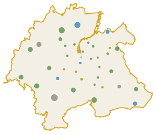 Torvdue (common)</td><td align="center">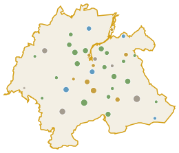 Rendsnude (common)</td><td align="center"> Mosbille (common)</td><td align="center">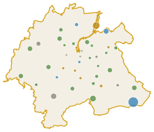 Grimælling (common)</td></tr>
<tr><td align="center"> Brokrabbe (uncommon)</td><td align="center">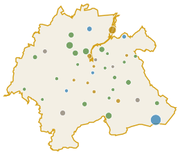 Kulingmåge (uncommon)</td><td align="center">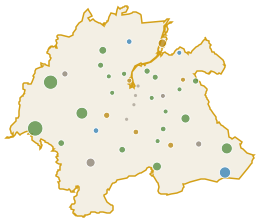 Lygtling (uncommon)</td><td align="center">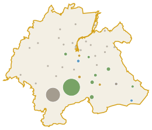 Loftnisse (rare)</td></tr>
<tr><td align="center">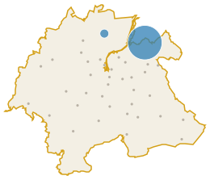 Søormling (rare)</td><td align="center">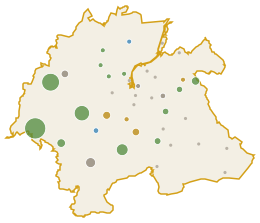 Kampetrold (rare)</td><td align="center">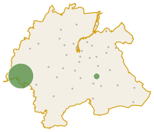 Ellepige (rare)</td><td align="center"> Gløding (uncommon)</td></tr>
<tr><td align="center">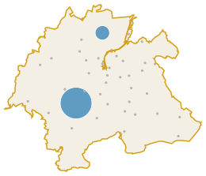 Rokkeling (uncommon)</td><td align="center">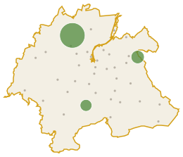 Mosling (common)</td><td align="center">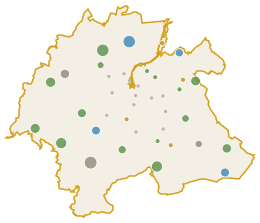 Lynspurv (uncommon)</td><td align="center">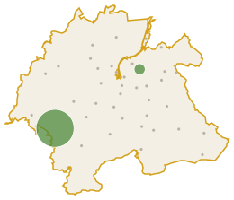 Dugpust (uncommon)</td></tr>
<tr><td align="center"> Flintling (uncommon)</td><td align="center"> Ræveling (common)</td><td align="center">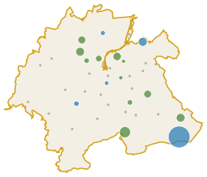 Nøkkeling (very rare)</td><td align="center">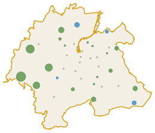 Ildflue (uncommon)</td></tr>
</table>

## Starter lines

Chosen at the start; never wild.

| Line (evolves at level) | Types |
|---|---|
| Gnistkat → Bålkat (16) → Brandløve (36) | fire → fire → fire/folk |
| Åodder → Strømodder (16) → Havodder (36) | water → water → water/folk |
| Bøgling → Bøgevætte (16) → Lundekonge (36) | grove → grove → grove/spirit |

## Every creature

| Creature | id | Types | Rarity | Base stats (HP/Atk/Def/Spd = total) | Catch rate | Evolves | Moves learned (level) |
|---|---|---|---|---|---|---|---|
| Gnistkat | `gnistkat` | fire | Common | 70/75/55/90 = 290 | 45 | Bålkat at 16 | Shoulder Shove (1), Stern Glare (1), Hearth Spark (5), Stoke Up (9), Squall Slap (12), Cinder Brand (13), Cobbler Kick (20), Kiln Blast (28) |
| Bålkat | `baalkat` | fire | Common | 90/105/80/110 = 385 | 45 | Brandløve at 36 | Shoulder Shove (1), Hearth Spark (1), Stoke Up (1), Squall Slap (12), Cinder Brand (13), Cobbler Kick (20), Kiln Blast (28), Nimble Jab (36) |
| Brandløve | `brandloeve` | fire/folk | Common | 104/136/96/64 = 400 | 45 | – | Hearth Spark (1), Stoke Up (8), Cobbler Kick (14), Ember Hop (16), Cinder Brand (22), Kiln Blast (30), Market Stampede (36), Forge Flare (40) |
| Åodder | `aaodder` | water | Common | 85/70/80/75 = 310 | 45 | Strømodder at 16 | Shoulder Shove (1), Sea Fog (1), Brook Spout (5), Nimble Jab (9), Cobble Toss (11), Rinse and Mend (13), Harbour Wave (22), Cobbler Kick (30) |
| Strømodder | `stroemodder` | water | Common | 100/95/95/100 = 390 | 45 | Havodder at 36 | Shoulder Shove (1), Brook Spout (1), Sea Fog (1), Cobble Toss (11), Rinse and Mend (13), Harbour Wave (22), Cobbler Kick (30), Squall Slap (40) |
| Havodder | `havodder` | water/folk | Common | 100/104/96/100 = 400 | 45 | – | Brook Spout (1), Sea Fog (8), Cobbler Kick (14), Ripple Dash (16), Rinse and Mend (24), Harbour Wave (30), Market Stampede (36), Fjord Surge (40) |
| Bøgling | `boegling` | grove | Common | 80/70/80/70 = 300 | 45 | Bøgevætte at 16 | Shoulder Shove (1), Beech Lash (1), Bark Skin (11), Cobble Toss (12), Drowsy Pollen (13), Nettle Sting (13), Sap Draw (18), Root Snare (25) |
| Bøgevætte | `boegevaette` | grove | Common | 100/95/95/95 = 385 | 45 | Lundekonge at 36 | Beech Lash (1), Bark Skin (1), Nettle Sting (1), Cobble Toss (12), Drowsy Pollen (13), Sap Draw (18), Root Snare (25), Hearty Meal (34) |
| Lundekonge | `lundekonge` | grove/spirit | Common | 112/88/132/68 = 400 | 45 | – | Beech Lash (1), Drowsy Pollen (6), Nettle Sting (12), Grave Chill (18), Root Snare (20), Thorn Volley (26), Hollow Wail (36), Beech Crown (40) |
| Torvdue | `torvdue` | folk | Common | 60/55/50/80 = 245 | 255 | Kirkedue at 18 | Shoulder Shove (1), Nimble Jab (3), Squall Slap (8), Gale Step (14), Cobbler Kick (22) |
| Kirkedue | `kirkedue` | folk | Common | 73/89/59/109 = 330 | 90 | Vinddue at 36 | Shoulder Shove (1), Stern Glare (1), Cobbler Kick (10), Cartwheel (20), Market Stampede (34) |
| Vinddue | `vinddue` | folk/storm | Common | 87/107/71/130 = 395 | 45 | – | Shoulder Shove (1), Stern Glare (1), Cobbler Kick (10), Gust Lance (18), Cartwheel (20), Market Stampede (34), Sky Crackle (36) |
| Rendsnude | `rendsnude` | folk | Common | 55/70/50/75 = 250 | 255 | Rottekonge at 24 | Shoulder Shove (1), Stern Glare (4), Nimble Jab (9), Blight Touch (15), Cobbler Kick (24) |
| Rottekonge | `rottekonge` | folk | Common | 99/129/91/61 = 380 | 90 | – | Shoulder Shove (1), Stern Glare (1), Cobbler Kick (10), Cartwheel (20), Market Stampede (34) |
| Mosbille | `mosbille` | grove | Common | 60/55/85/45 = 245 | 200 | Skovbille at 14 | Shoulder Shove (1), Bark Skin (1), Beech Lash (6), Nettle Sting (12), Root Snare (20) |
| Skovbille | `skovbille` | grove | Common | 92/73/109/56 = 330 | 90 | Eghjort at 32 | Beech Lash (1), Drowsy Pollen (6), Nettle Sting (12), Cobbler Kick (14), Root Snare (20), Thorn Volley (26), Beech Crown (40) |
| Eghjort | `eghjort` | grove/stone | Common | 111/88/131/68 = 398 | 45 | – | Beech Lash (1), Drowsy Pollen (6), Nettle Sting (12), Boulder Roll (18), Root Snare (20), Thorn Volley (26), Rune Slab (36), Beech Crown (40) |
| Grimælling | `grimaelling` | water | Common | 65/55/60/70 = 250 | 200 | Svaneunge at 18 | Shoulder Shove (1), Brook Spout (4), Sea Fog (10), Rinse and Mend (16), Harbour Wave (26) |
| Svaneunge | `svaneunge` | water | Common | 83/86/79/82 = 330 | 90 | Kongesvane at 36 | Brook Spout (1), Sea Fog (8), Cobbler Kick (14), Ripple Dash (16), Rinse and Mend (24), Harbour Wave (30), Fjord Surge (40) |
| Kongesvane | `kongesvane` | water/storm | Common | 100/103/96/99 = 398 | 45 | – | Brook Spout (1), Sea Fog (8), Ripple Dash (16), Gust Lance (18), Rinse and Mend (24), Harbour Wave (30), Sky Crackle (36), Fjord Surge (40) |
| Brokrabbe | `brokrabbe` | stone | Uncommon | 70/85/100/45 = 300 | 120 | Kæmpekrabbe at 28 | Shoulder Shove (1), Hunker Down (1), Cobble Toss (6), Grit Spray (12), Brook Spout (20), Rampart Slam (30) |
| Kæmpekrabbe | `kaempekrabbe` | stone/water | Uncommon | 111/87/130/67 = 395 | 60 | – | Cobble Toss (1), Hunker Down (6), Grit Spray (12), Ripple Dash (18), Boulder Roll (22), Rampart Slam (32), Harbour Wave (36), Rune Slab (40) |
| Kulingmåge | `kulingmaage` | storm | Uncommon | 65/75/55/105 = 300 | 120 | Stormmåge at 30 | Squall Slap (1), Nimble Jab (1), Gale Step (8), Prickle Charge (14), Sky Crackle (22), Brook Spout (30) |
| Stormmåge | `stormmaage` | storm | Uncommon | 87/107/71/130 = 395 | 60 | – | Squall Slap (1), Gale Step (8), Cobbler Kick (14), Gust Lance (18), Sky Crackle (26), Thunder Squall (40) |
| Lygtling | `lygtling` | spirit | Uncommon | 60/80/60/100 = 300 | 120 | Lygtemand at 24 | Wisp Flicker (1), Moonless Stare (1), Hearth Spark (8), Blight Touch (14), Hollow Wail (22), Lullaby Hum (30) |
| Lygtemand | `lygtemand` | spirit/fire | Uncommon | 87/107/71/130 = 395 | 60 | – | Wisp Flicker (1), Moonless Stare (6), Blight Touch (12), Grave Chill (18), Ember Hop (18), Hollow Wail (26), Kiln Blast (36), Elf Dance (40) |
| Loftnisse | `loftnisse` | folk/spirit | Rare | 90/95/90/95 = 370 | 30 | Gårdnisse at 34 | Shoulder Shove (1), Wisp Flicker (1), Lullaby Hum (10), Cobbler Kick (18), Hollow Wail (26), Hearty Meal (34), Moonless Stare (42) |
| Gårdnisse | `gaardnisse` | folk/spirit | Rare | 100/104/96/100 = 400 | 25 | – | Shoulder Shove (1), Stern Glare (1), Cobbler Kick (10), Grave Chill (18), Cartwheel (20), Market Stampede (34), Hollow Wail (36) |
| Søormling | `soeormling` | stone/water | Rare | 95/100/95/80 = 370 | 30 | Lindorm at 38 | Brook Spout (1), Cobble Toss (1), Grit Spray (12), Harbour Wave (20), Hunker Down (28), Rampart Slam (36), Sea Fog (44) |
| Lindorm | `lindorm` | stone/water | Rare | 104/136/96/64 = 400 | 25 | – | Cobble Toss (1), Hunker Down (6), Grit Spray (12), Ripple Dash (18), Boulder Roll (22), Rampart Slam (32), Harbour Wave (36), Rune Slab (40) |
| Kampetrold | `kampetrold` | stone | Rare | 85/90/95/50 = 320 | 45 | Bjergtrold at 36 | Shoulder Shove (1), Hunker Down (1), Cobble Toss (8), Stern Glare (12), Grit Spray (16), Cobbler Kick (22), Rampart Slam (32) |
| Bjergtrold | `bjergtrold` | stone | Rare | 104/136/96/64 = 400 | 25 | – | Cobble Toss (1), Hunker Down (6), Grit Spray (12), Cobbler Kick (14), Boulder Roll (22), Rampart Slam (32), Rune Slab (40) |
| Ellepige | `ellepige` | grove/spirit | Rare | 80/85/75/90 = 330 | 45 | Ellekonge at 38 | Beech Lash (1), Wisp Flicker (1), Drowsy Pollen (10), Root Snare (16), Hollow Wail (24), Sap Draw (30), Moonless Stare (38) |
| Ellekonge | `ellekonge` | grove/spirit | Rare | 100/104/96/100 = 400 | 25 | – | Beech Lash (1), Drowsy Pollen (6), Nettle Sting (12), Grave Chill (18), Root Snare (20), Thorn Volley (26), Hollow Wail (36), Beech Crown (40) |
| Gløding | `gloeding` | fire | Uncommon | 59/73/49/89 = 270 | 140 | Glødøgle at 18 | Hearth Spark (1), Stoke Up (8), Cobbler Kick (14), Ember Hop (16), Cinder Brand (22), Kiln Blast (30), Forge Flare (40) |
| Glødøgle | `gloedoegle` | fire | Uncommon | 76/93/62/114 = 345 | 60 | Essedrage at 38 | Hearth Spark (1), Stoke Up (8), Cobbler Kick (14), Ember Hop (16), Cinder Brand (22), Kiln Blast (30), Forge Flare (40) |
| Essedrage | `essedrage` | fire/storm | Uncommon | 104/136/96/64 = 400 | 30 | – | Hearth Spark (1), Stoke Up (8), Ember Hop (16), Gust Lance (18), Cinder Brand (22), Kiln Blast (30), Sky Crackle (36), Forge Flare (40) |
| Rokkeling | `rokkeling` | water | Uncommon | 71/74/68/72 = 285 | 140 | Rokkevinge at 30 | Brook Spout (1), Sea Fog (8), Cobbler Kick (14), Ripple Dash (16), Rinse and Mend (24), Harbour Wave (30), Fjord Surge (40) |
| Rokkevinge | `rokkevinge` | water/storm | Uncommon | 86/105/70/129 = 390 | 60 | – | Brook Spout (1), Sea Fog (8), Ripple Dash (16), Gust Lance (18), Rinse and Mend (24), Harbour Wave (30), Sky Crackle (36), Fjord Surge (40) |
| Mosling | `mosling` | grove | Common | 71/56/84/44 = 255 | 220 | Mostrold at 20 | Beech Lash (1), Drowsy Pollen (6), Nettle Sting (12), Cobbler Kick (14), Root Snare (20), Thorn Volley (26), Beech Crown (40) |
| Mostrold | `mostrold` | grove | Common | 94/74/111/56 = 335 | 90 | Lyngkonge at 36 | Beech Lash (1), Drowsy Pollen (6), Nettle Sting (12), Cobbler Kick (14), Root Snare (20), Thorn Volley (26), Beech Crown (40) |
| Lyngkonge | `lyngkonge` | grove/folk | Common | 100/103/96/99 = 398 | 45 | – | Beech Lash (1), Drowsy Pollen (6), Nettle Sting (12), Cobbler Kick (14), Root Snare (20), Thorn Volley (26), Market Stampede (36), Beech Crown (40) |
| Lynspurv | `lynspurv` | storm | Uncommon | 58/72/48/87 = 265 | 140 | Tordenkrage at 20 | Squall Slap (1), Gale Step (8), Cobbler Kick (14), Gust Lance (18), Sky Crackle (26), Thunder Squall (40) |
| Tordenkrage | `tordenkrage` | storm | Uncommon | 75/92/61/112 = 340 | 60 | Tordenravn at 38 | Squall Slap (1), Gale Step (8), Cobbler Kick (14), Gust Lance (18), Sky Crackle (26), Thunder Squall (40) |
| Tordenravn | `tordenravn` | storm/spirit | Uncommon | 88/108/72/132 = 400 | 30 | – | Squall Slap (1), Gale Step (8), Gust Lance (18), Grave Chill (18), Sky Crackle (26), Hollow Wail (36), Thunder Squall (40) |
| Dugpust | `dugpust` | spirit | Uncommon | 70/73/67/70 = 280 | 140 | Mosekone at 30 | Wisp Flicker (1), Moonless Stare (6), Blight Touch (12), Cobbler Kick (14), Grave Chill (18), Hollow Wail (26), Elf Dance (40) |
| Mosekone | `mosekone` | spirit/grove | Uncommon | 98/101/94/97 = 390 | 60 | – | Wisp Flicker (1), Moonless Stare (6), Blight Touch (12), Grave Chill (18), Thorn Volley (18), Hollow Wail (26), Beech Crown (36), Elf Dance (40) |
| Flintling | `flintling` | stone | Uncommon | 80/63/94/48 = 285 | 140 | Flintbjørn at 32 | Cobble Toss (1), Hunker Down (6), Grit Spray (12), Cobbler Kick (14), Boulder Roll (22), Rampart Slam (32), Rune Slab (40) |
| Flintbjørn | `flintbjoern` | stone/folk | Uncommon | 102/133/94/63 = 392 | 60 | – | Cobble Toss (1), Hunker Down (6), Grit Spray (12), Cobbler Kick (14), Boulder Roll (22), Rampart Slam (32), Market Stampede (36), Rune Slab (40) |
| Ræveling | `raeveling` | folk | Common | 59/73/49/89 = 270 | 220 | Mikkelræv at 24 | Shoulder Shove (1), Stern Glare (1), Cobbler Kick (10), Cartwheel (20), Market Stampede (34) |
| Mikkelræv | `mikkelraev` | folk/grove | Common | 85/104/69/127 = 385 | 90 | – | Shoulder Shove (1), Stern Glare (1), Cobbler Kick (10), Thorn Volley (18), Cartwheel (20), Market Stampede (34), Beech Crown (36) |
| Nøkkeling | `noekkeling` | water/spirit | Very rare | 80/83/77/80 = 320 | 15 | Nøkken at 35 | Brook Spout (1), Sea Fog (8), Ripple Dash (16), Grave Chill (18), Rinse and Mend (24), Harbour Wave (30), Hollow Wail (36), Fjord Surge (40) |
| Nøkken | `noekken` | water/spirit | Very rare | 100/104/96/100 = 400 | 8 | – | Brook Spout (1), Sea Fog (8), Ripple Dash (16), Grave Chill (18), Rinse and Mend (24), Harbour Wave (30), Hollow Wail (36), Fjord Surge (40) |
| Ildflue | `ildflue` | fire/grove | Uncommon | 61/74/50/90 = 275 | 140 | Gløddronning at 28 | Hearth Spark (1), Stoke Up (8), Ember Hop (16), Thorn Volley (18), Cinder Brand (22), Kiln Blast (30), Beech Crown (36), Forge Flare (40) |
| Gløddronning | `gloeddronning` | fire/grove | Uncommon | 85/105/70/128 = 388 | 60 | – | Hearth Spark (1), Stoke Up (8), Ember Hop (16), Thorn Volley (18), Cinder Brand (22), Kiln Blast (30), Beech Crown (36), Forge Flare (40) |

## Spawn tables by district

Weight is the table weight before biome fit; "rare" entries use the district's level band. Destination-only entries never appear outside destinations.

### District 1: Centrum (levels 3–8)

| Creature | Weight | Level band | Time | Biomes | Only in destinations | Needs |
|---|---|---|---|---|---|---|
| Torvdue | 25 | player's | any | urban 1, park 1, historic 0.6, meadow 0.5, farmland 0.6 |  |  |
| Rendsnude | 25 | player's | any | urban 1, industrial 1.5, historic 0.6 |  |  |
| Mosbille | 25 | player's | any | park 1, forest 1.5, meadow 1, farmland 0.6 |  |  |
| Grimælling | 25 | player's | any | water 2, park 0.3, meadow 0.3 |  |  |
| Ræveling | 25 | player's | any | forest 1, farmland 1, park 0.8, urban 0.3 |  |  |
| Mosling | 25 | player's | any | forest 1.5, meadow 1, farmland 0.8, park 0.5 | yes |  |
| Brokrabbe | 18 | player's | any | historic 2, urban 0.3, water 0.3 |  |  |
| Kulingmåge | 9 | player's | any | water 1, industrial 0.5, urban 0.2 |  |  |
| Lygtling | 9 | player's | night | park 1, forest 1, historic 1, water 1 |  |  |
| Gløding | 9 | player's | any | industrial 1.5, urban 0.6, historic 0.4 |  |  |
| Lynspurv | 9 | player's | any | farmland 1.5, meadow 1, urban 0.3 |  |  |
| Flintling | 9 | player's | any | historic 1, industrial 1, urban 0.4, farmland 0.3 |  |  |
| Rokkeling | 9 | player's | any | water 2 | yes |  |
| Dugpust | 9 | player's | any | meadow 1.5, farmland 1, water 0.5 | yes |  |
| Ildflue | 9 | player's | night | meadow 1, forest 1, farmland 0.6 | yes |  |
| Loftnisse | 2.5 | district | any | historic 2, urban 0.3 |  |  |
| Loftnisse | 4 | district | any | historic 2, urban 0.2 |  | runereader |
| Mosbille | 4 | district | any | forest 2, park 1 |  | forager |
| Søormling | 2.5 | district | any | water 2 | yes |  |
| Nøkkeling | 0.8 | district | any | water 2 | yes |  |

### District 2: Næsbyhoved and Stavis Å (levels 8–14)

| Creature | Weight | Level band | Time | Biomes | Only in destinations | Needs |
|---|---|---|---|---|---|---|
| Torvdue | 25 | player's | any | urban 1, park 1, historic 0.6, meadow 0.5, farmland 0.6 |  |  |
| Rendsnude | 25 | player's | any | urban 1, industrial 1.5, historic 0.6 |  |  |
| Mosbille | 25 | player's | any | park 1, forest 1.5, meadow 1, farmland 0.6 |  |  |
| Grimælling | 25 | player's | any | water 2, park 0.3, meadow 0.3 |  |  |
| Ræveling | 25 | player's | any | forest 1, farmland 1, park 0.8, urban 0.3 |  |  |
| Mosling | 25 | player's | any | forest 1.5, meadow 1, farmland 0.8, park 0.5 | yes |  |
| Brokrabbe | 9 | player's | any | historic 2, urban 0.3, water 0.3 |  |  |
| Kulingmåge | 18 | player's | any | water 1, industrial 0.5, urban 0.2 |  |  |
| Lygtling | 9 | player's | night | park 1, forest 1, historic 1, water 1 |  |  |
| Gløding | 9 | player's | any | industrial 1.5, urban 0.6, historic 0.4 |  |  |
| Lynspurv | 9 | player's | any | farmland 1.5, meadow 1, urban 0.3 |  |  |
| Flintling | 9 | player's | any | historic 1, industrial 1, urban 0.4, farmland 0.3 |  |  |
| Rokkeling | 9 | player's | any | water 2 | yes |  |
| Dugpust | 9 | player's | any | meadow 1.5, farmland 1, water 0.5 | yes |  |
| Ildflue | 9 | player's | night | meadow 1, forest 1, farmland 0.6 | yes |  |
| Kampetrold | 2.5 | district | any | historic 2, urban 0.4 |  |  |
| Ellepige | 2.5 | district | any | forest 2, park 0.5 | yes |  |
| Søormling | 2.5 | district | any | water 2 | yes |  |
| Nøkkeling | 0.8 | district | any | water 2 | yes |  |

### District 3: The fjord (levels 13–20)

| Creature | Weight | Level band | Time | Biomes | Only in destinations | Needs |
|---|---|---|---|---|---|---|
| Torvdue | 25 | player's | any | urban 1, park 1, historic 0.6, meadow 0.5, farmland 0.6 |  |  |
| Rendsnude | 25 | player's | any | urban 1, industrial 1.5, historic 0.6 |  |  |
| Mosbille | 25 | player's | any | park 1, forest 1.5, meadow 1, farmland 0.6 |  |  |
| Grimælling | 25 | player's | any | water 2, park 0.3, meadow 0.3 |  |  |
| Ræveling | 25 | player's | any | forest 1, farmland 1, park 0.8, urban 0.3 |  |  |
| Mosling | 25 | player's | any | forest 1.5, meadow 1, farmland 0.8, park 0.5 | yes |  |
| Brokrabbe | 9 | player's | any | historic 2, urban 0.3, water 0.3 |  |  |
| Kulingmåge | 9 | player's | any | water 1, industrial 0.5, urban 0.2 |  |  |
| Lygtling | 9 | player's | night | park 1, forest 1, historic 1, water 1 |  |  |
| Gløding | 9 | player's | any | industrial 1.5, urban 0.6, historic 0.4 |  |  |
| Lynspurv | 9 | player's | any | farmland 1.5, meadow 1, urban 0.3 |  |  |
| Flintling | 9 | player's | any | historic 1, industrial 1, urban 0.4, farmland 0.3 |  |  |
| Rokkeling | 18 | player's | any | water 2 | yes |  |
| Dugpust | 9 | player's | any | meadow 1.5, farmland 1, water 0.5 | yes |  |
| Ildflue | 9 | player's | night | meadow 1, forest 1, farmland 0.6 | yes |  |
| Søormling | 2.5 | district | any | water 2 | yes |  |
| Søormling | 4 | district | any | water 2 |  | angler |
| Ellepige | 2.5 | district | any | forest 2, park 0.5 | yes |  |
| Nøkkeling | 0.8 | district | any | water 2 | yes |  |

### District 4: The eastern woods (levels 19–26)

| Creature | Weight | Level band | Time | Biomes | Only in destinations | Needs |
|---|---|---|---|---|---|---|
| Torvdue | 25 | player's | any | urban 1, park 1, historic 0.6, meadow 0.5, farmland 0.6 |  |  |
| Rendsnude | 25 | player's | any | urban 1, industrial 1.5, historic 0.6 |  |  |
| Mosbille | 25 | player's | any | park 1, forest 1.5, meadow 1, farmland 0.6 |  |  |
| Grimælling | 25 | player's | any | water 2, park 0.3, meadow 0.3 |  |  |
| Ræveling | 25 | player's | any | forest 1, farmland 1, park 0.8, urban 0.3 |  |  |
| Mosling | 25 | player's | any | forest 1.5, meadow 1, farmland 0.8, park 0.5 | yes |  |
| Brokrabbe | 9 | player's | any | historic 2, urban 0.3, water 0.3 |  |  |
| Kulingmåge | 9 | player's | any | water 1, industrial 0.5, urban 0.2 |  |  |
| Lygtling | 9 | player's | night | park 1, forest 1, historic 1, water 1 |  |  |
| Gløding | 9 | player's | any | industrial 1.5, urban 0.6, historic 0.4 |  |  |
| Lynspurv | 9 | player's | any | farmland 1.5, meadow 1, urban 0.3 |  |  |
| Flintling | 18 | player's | any | historic 1, industrial 1, urban 0.4, farmland 0.3 |  |  |
| Rokkeling | 9 | player's | any | water 2 | yes |  |
| Dugpust | 9 | player's | any | meadow 1.5, farmland 1, water 0.5 | yes |  |
| Ildflue | 9 | player's | night | meadow 1, forest 1, farmland 0.6 | yes |  |
| Ellepige | 2.5 | district | any | forest 2, park 0.5 | yes |  |
| Ellepige | 4 | district | any | forest 2 |  | forager |
| Kampetrold | 2.5 | district | any | historic 1, park 0.5, urban 0.5, forest 0.5 |  |  |

### District 5: Hollufgård and Fraugde (levels 25–32)

| Creature | Weight | Level band | Time | Biomes | Only in destinations | Needs |
|---|---|---|---|---|---|---|
| Torvdue | 25 | player's | any | urban 1, park 1, historic 0.6, meadow 0.5, farmland 0.6 |  |  |
| Rendsnude | 25 | player's | any | urban 1, industrial 1.5, historic 0.6 |  |  |
| Mosbille | 25 | player's | any | park 1, forest 1.5, meadow 1, farmland 0.6 |  |  |
| Grimælling | 25 | player's | any | water 2, park 0.3, meadow 0.3 |  |  |
| Ræveling | 25 | player's | any | forest 1, farmland 1, park 0.8, urban 0.3 |  |  |
| Mosling | 25 | player's | any | forest 1.5, meadow 1, farmland 0.8, park 0.5 | yes |  |
| Brokrabbe | 9 | player's | any | historic 2, urban 0.3, water 0.3 |  |  |
| Kulingmåge | 9 | player's | any | water 1, industrial 0.5, urban 0.2 |  |  |
| Lygtling | 9 | player's | night | park 1, forest 1, historic 1, water 1 |  |  |
| Gløding | 9 | player's | any | industrial 1.5, urban 0.6, historic 0.4 |  |  |
| Lynspurv | 9 | player's | any | farmland 1.5, meadow 1, urban 0.3 |  |  |
| Flintling | 9 | player's | any | historic 1, industrial 1, urban 0.4, farmland 0.3 |  |  |
| Rokkeling | 9 | player's | any | water 2 | yes |  |
| Dugpust | 18 | player's | any | meadow 1.5, farmland 1, water 0.5 | yes |  |
| Ildflue | 9 | player's | night | meadow 1, forest 1, farmland 0.6 | yes |  |
| Loftnisse | 2.5 | district | any | historic 2, urban 0.5, park 0.3 |  |  |
| Ellepige | 2.5 | district | any | forest 2, park 0.5 | yes |  |
| Søormling | 2.5 | district | any | water 2 | yes |  |
| Nøkkeling | 0.8 | district | any | water 2 | yes |  |

### District 6: Dalum and Hjallese (levels 31–38)

| Creature | Weight | Level band | Time | Biomes | Only in destinations | Needs |
|---|---|---|---|---|---|---|
| Torvdue | 25 | player's | any | urban 1, park 1, historic 0.6, meadow 0.5, farmland 0.6 |  |  |
| Rendsnude | 25 | player's | any | urban 1, industrial 1.5, historic 0.6 |  |  |
| Mosbille | 25 | player's | any | park 1, forest 1.5, meadow 1, farmland 0.6 |  |  |
| Grimælling | 25 | player's | any | water 2, park 0.3, meadow 0.3 |  |  |
| Ræveling | 25 | player's | any | forest 1, farmland 1, park 0.8, urban 0.3 |  |  |
| Mosling | 25 | player's | any | forest 1.5, meadow 1, farmland 0.8, park 0.5 | yes |  |
| Brokrabbe | 9 | player's | any | historic 2, urban 0.3, water 0.3 |  |  |
| Kulingmåge | 9 | player's | any | water 1, industrial 0.5, urban 0.2 |  |  |
| Lygtling | 9 | player's | night | park 1, forest 1, historic 1, water 1 |  |  |
| Gløding | 18 | player's | any | industrial 1.5, urban 0.6, historic 0.4 |  |  |
| Lynspurv | 9 | player's | any | farmland 1.5, meadow 1, urban 0.3 |  |  |
| Flintling | 9 | player's | any | historic 1, industrial 1, urban 0.4, farmland 0.3 |  |  |
| Rokkeling | 9 | player's | any | water 2 | yes |  |
| Dugpust | 9 | player's | any | meadow 1.5, farmland 1, water 0.5 | yes |  |
| Ildflue | 9 | player's | night | meadow 1, forest 1, farmland 0.6 | yes |  |
| Loftnisse | 2.5 | district | any | historic 1.5, farmland 1, urban 0.3 |  |  |
| Ellepige | 2.5 | district | any | forest 2, park 0.5 | yes |  |
| Kampetrold | 2.5 | district | any | historic 1, park 0.5, urban 0.5, forest 0.5 |  |  |

### District 7: Zoo and Sanderum (levels 37–44)

| Creature | Weight | Level band | Time | Biomes | Only in destinations | Needs |
|---|---|---|---|---|---|---|
| Torvdue | 25 | player's | any | urban 1, park 1, historic 0.6, meadow 0.5, farmland 0.6 |  |  |
| Rendsnude | 25 | player's | any | urban 1, industrial 1.5, historic 0.6 |  |  |
| Mosbille | 25 | player's | any | park 1, forest 1.5, meadow 1, farmland 0.6 |  |  |
| Grimælling | 25 | player's | any | water 2, park 0.3, meadow 0.3 |  |  |
| Ræveling | 25 | player's | any | forest 1, farmland 1, park 0.8, urban 0.3 |  |  |
| Mosling | 25 | player's | any | forest 1.5, meadow 1, farmland 0.8, park 0.5 | yes |  |
| Brokrabbe | 9 | player's | any | historic 2, urban 0.3, water 0.3 |  |  |
| Kulingmåge | 9 | player's | any | water 1, industrial 0.5, urban 0.2 |  |  |
| Lygtling | 9 | player's | night | park 1, forest 1, historic 1, water 1 |  |  |
| Gløding | 9 | player's | any | industrial 1.5, urban 0.6, historic 0.4 |  |  |
| Lynspurv | 18 | player's | any | farmland 1.5, meadow 1, urban 0.3 |  |  |
| Flintling | 9 | player's | any | historic 1, industrial 1, urban 0.4, farmland 0.3 |  |  |
| Rokkeling | 9 | player's | any | water 2 | yes |  |
| Dugpust | 9 | player's | any | meadow 1.5, farmland 1, water 0.5 | yes |  |
| Ildflue | 9 | player's | night | meadow 1, forest 1, farmland 0.6 | yes |  |
| Søormling | 2.5 | district | any | water 2, park 0.3 | yes |  |
| Kampetrold | 2.5 | district | any | park 0.5, urban 0.5, historic 1 |  |  |
| Nøkkeling | 0.8 | district | any | water 2 | yes |  |

### District 8: The western woods (levels 43–50)

| Creature | Weight | Level band | Time | Biomes | Only in destinations | Needs |
|---|---|---|---|---|---|---|
| Torvdue | 25 | player's | any | urban 1, park 1, historic 0.6, meadow 0.5, farmland 0.6 |  |  |
| Rendsnude | 25 | player's | any | urban 1, industrial 1.5, historic 0.6 |  |  |
| Mosbille | 25 | player's | any | park 1, forest 1.5, meadow 1, farmland 0.6 |  |  |
| Grimælling | 25 | player's | any | water 2, park 0.3, meadow 0.3 |  |  |
| Ræveling | 25 | player's | any | forest 1, farmland 1, park 0.8, urban 0.3 |  |  |
| Mosling | 25 | player's | any | forest 1.5, meadow 1, farmland 0.8, park 0.5 | yes |  |
| Brokrabbe | 9 | player's | any | historic 2, urban 0.3, water 0.3 |  |  |
| Kulingmåge | 9 | player's | any | water 1, industrial 0.5, urban 0.2 |  |  |
| Lygtling | 9 | player's | night | park 1, forest 1, historic 1, water 1 |  |  |
| Gløding | 9 | player's | any | industrial 1.5, urban 0.6, historic 0.4 |  |  |
| Lynspurv | 9 | player's | any | farmland 1.5, meadow 1, urban 0.3 |  |  |
| Flintling | 9 | player's | any | historic 1, industrial 1, urban 0.4, farmland 0.3 |  |  |
| Rokkeling | 9 | player's | any | water 2 | yes |  |
| Dugpust | 9 | player's | any | meadow 1.5, farmland 1, water 0.5 | yes |  |
| Ildflue | 18 | player's | night | meadow 1, forest 1, farmland 0.6 | yes |  |
| Søormling | 2.5 | district | any | water 2 | yes |  |
| Ellepige | 2.5 | district | any | forest 2, park 0.5 | yes |  |
| Kampetrold | 2.5 | district | any | historic 1, park 0.5, urban 0.5, forest 0.5 |  |  |
