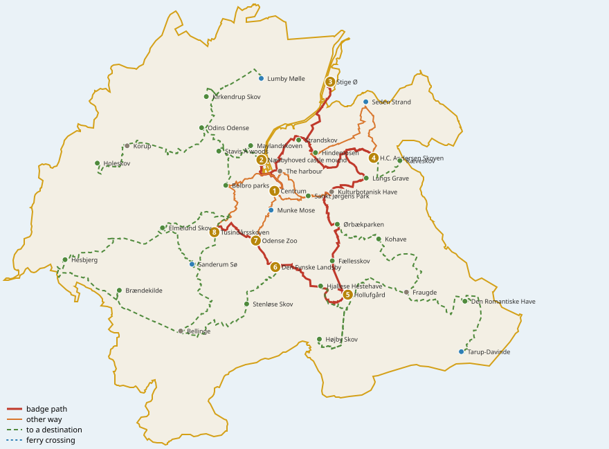

# Odense

<!-- Generated by `pnpm docs:content` (tools/docs) from the content files. Do not edit by hand. -->

Region `odense`: 39 zones in 8 districts, 50 walking routes (173.9 km), 8 arenas, 55 creatures, 129 trainers. State and features: [REGIONS.md](../../REGIONS.md).

## Arenas

| # | Site | Zone | Theme | Badge |
| --- | --- | --- | --- | --- |
| 1 | Kongens Have | Centrum | folk | Kongens Have badge |
| 2 | Næsbyhoved castle mound | Næsbyhoved castle mound | stone | Castle Mound badge |
| 3 | Stige Ø | Stige Ø | water | Fjord badge |
| 4 | H.C. Andersen Skoven | H.C. Andersen Skoven | grove | Fairy-tale Forest badge |
| 5 | Hollufgård | Hollufgård | spirit | Sculpture badge |
| 6 | Den Fynske Landsby | Den Fynske Landsby | fire | Village badge |
| 7 | Odense Zoo | Odense Zoo | mixed | Zoo badge |
| 8 | Tusindårsskoven | Tusindårsskoven | storm | Hilltop badge |

## Zones

| Zone | id | Kind | District | Notes |
| --- | --- | --- | --- | --- |
| Bolbro parks | `bolbro` | wild (field) | 1 |  |
| Centrum | `centrum` | arena | 1 | start, arena 1 |
| Munke Mose | `munkemose` | water (lake) | 1 |  |
| Sankt Jørgens Park | `sktjoergen` | wild (field) | 1 |  |
| The harbour | `havnen` | town (town) | 2 |  |
| Kirkendrup Skov | `kirkendrup` | wild (forest) | 2 |  |
| Lumby Mølle | `lumby` | water (lake) | 2 |  |
| Maylandskoven | `maylandskoven` | wild (forest) | 2 |  |
| Næsbyhoved castle mound | `naesbyhoved` | arena | 2 | arena 2 |
| Odins Odense | `odins` | wild (field) | 2 |  |
| Stavis Å woods | `stavis` | wild (forest) | 2 |  |
| Hindemosen | `hindemosen` | wild (field) | 3 |  |
| Seden Strand | `seden` | water (lake) | 3 |  |
| Stige Ø | `stige` | arena | 3 | arena 3 |
| Strandskov | `strandskov` | wild (forest) | 3 |  |
| Kulturbotanisk Have | `botanisk` | town (town) | 4 |  |
| H.C. Andersen Skoven | `hcaskoven` | arena | 4 | arena 4 |
| Lungs Grave | `lungsgrave` | wild (forest) | 4 |  |
| Ørbækparken | `oerbaek` | wild (field) | 4 |  |
| Ræveskov | `raeveskov` | wild (forest) | 4 |  |
| Fællesskov | `faellesskov` | wild (forest) | 5 |  |
| Fraugde | `fraugde` | town (town) | 5 |  |
| Højby Skov | `hoejby` | wild (forest) | 5 |  |
| Hollufgård | `hollufgaard` | arena | 5 | arena 5 |
| Kohave | `kohave` | wild (forest) | 5 |  |
| Den Romantiske Have | `romantiskehave` | wild (field) | 5 |  |
| Tarup-Davinde | `tarupdavinde` | water (lake) | 5 |  |
| Bellinge | `bellinge` | town (town) | 6 |  |
| Den Fynske Landsby | `fynskelandsby` | arena | 6 | arena 6 |
| Hjallese Hestehave | `hjallese` | wild (forest) | 6 |  |
| Stenløse Skov | `stenloese` | wild (forest) | 6 |  |
| Sanderum Sø | `sanderum` | water (lake) | 7 |  |
| Odense Zoo | `zoo` | arena | 7 | arena 7 |
| Brændekilde | `braendekilde` | wild (field) | 8 |  |
| Elmelund Skov | `elmelund` | wild (forest) | 8 |  |
| Hesbjerg | `hesbjerg` | wild (forest) | 8 |  |
| Holeskov | `holeskov` | wild (forest) | 8 |  |
| Korup | `korup` | town (town) | 8 |  |
| Tusindårsskoven | `tusindaar` | arena | 8 | arena 8 |

## Routes

| # | From | To | Kind | Length | Wild |
| --- | --- | --- | --- | --- | --- |
| 1 | Centrum | Næsbyhoved castle mound | main | 3.1 km | 31 % |
| 2 | Næsbyhoved castle mound | The harbour | main | 2.4 km | 36 % |
| 3 | The harbour | Strandskov | main | 2.8 km | 8 % |
| 4 | Strandskov | Stige Ø | main | 4.1 km | 65 % |
| 5 | Strandskov | Hindemosen | main | 1.4 km | 91 % |
| 6 | Hindemosen | H.C. Andersen Skoven | main | 4.7 km | 29 % |
| 7 | H.C. Andersen Skoven | Lungs Grave | main | 3.5 km | 27 % |
| 8 | Lungs Grave | Kulturbotanisk Have | main | 2.3 km | 40 % |
| 9 | Kulturbotanisk Have | Ørbækparken | main | 2.7 km | 15 % |
| 10 | Ørbækparken | Fællesskov | main | 2.2 km | 37 % |
| 11 | Fællesskov | Hollufgård | main | 2.6 km | 33 % |
| 12 | Hollufgård | Hjallese Hestehave | main | 2.7 km | 95 % |
| 13 | Hjallese Hestehave | Den Fynske Landsby | main | 3.3 km | 50 % |
| 14 | Den Fynske Landsby | Odense Zoo | main | 1.9 km | 80 % |
| 15 | Odense Zoo | Tusindårsskoven | main | 3.0 km | 62 % |
| 16 | Centrum | The harbour | alt | 1.6 km | 7 % |
| 17 | The harbour | Sankt Jørgens Park | alt | 2.4 km | 30 % |
| 18 | Sankt Jørgens Park | Kulturbotanisk Have | alt | 1.5 km | 29 % |
| 19 | Centrum | Sankt Jørgens Park | alt | 2.5 km | 25 % |
| 20 | Centrum | Munke Mose | alt | 1.2 km | 28 % |
| 21 | Munke Mose | Odense Zoo | alt | 2.4 km | 49 % |
| 22 | Centrum | Bolbro parks | alt | 4.7 km | 30 % |
| 23 | Bolbro parks | Tusindårsskoven | alt | 3.8 km | 30 % |
| 24 | Hindemosen | Seden Strand | alt | 5.1 km | 33 % |
| 25 | Seden Strand | H.C. Andersen Skoven | alt | 3.4 km | 16 % |
| 26 | Næsbyhoved castle mound | Maylandskoven | explore | 1.5 km | 42 % |
| 27 | Maylandskoven | Stavis Å woods | explore | 2.5 km | 53 % |
| 28 | Bolbro parks | Stavis Å woods | explore | 2.4 km | 40 % |
| 29 | Stavis Å woods | Odins Odense | explore | 2.2 km | 91 % |
| 30 | Odins Odense | Kirkendrup Skov | explore | 3.1 km | 46 % |
| 31 | Kirkendrup Skov | Lumby Mølle | explore | 3.7 km | 22 % |
| 32 | Odins Odense | Korup | explore | 5.7 km | 31 % |
| 33 | Korup | Holeskov | explore | 3.4 km | 63 % |
| 34 | Tusindårsskoven | Sanderum Sø | explore | 2.6 km | 59 % |
| 35 | Tusindårsskoven | Elmelund Skov | explore | 5.9 km | 66 % |
| 36 | Elmelund Skov | Sanderum Sø | explore | 3.4 km | 56 % |
| 37 | Elmelund Skov | Hesbjerg | explore | 6.9 km | 33 % |
| 38 | Hesbjerg | Brændekilde | explore | 5.4 km | 49 % |
| 39 | Sanderum Sø | Bellinge | explore | 5.4 km | 14 % |
| 40 | Bellinge | Brændekilde | explore | 4.2 km | 8 % |
| 41 | Bellinge | Stenløse Skov | explore | 5.2 km | 46 % |
| 42 | Den Fynske Landsby | Stenløse Skov | explore | 3.0 km | 43 % |
| 43 | Hollufgård | Højby Skov | explore | 4.5 km | 28 % |
| 44 | Højby Skov | Hjallese Hestehave | explore | 5.9 km | 47 % |
| 45 | Ørbækparken | Kohave | explore | 3.1 km | 61 % |
| 46 | H.C. Andersen Skoven | Ræveskov | explore | 3.0 km | 39 % |
| 47 | Hollufgård | Fraugde | explore | 4.2 km | 23 % |
| 48 | Kohave | Fraugde | explore | 5.6 km | 23 % |
| 49 | Fraugde | Den Romantiske Have | explore | 4.7 km | 48 % |
| 50 | Den Romantiske Have | Tarup-Davinde | explore | 4.9 km | 56 % |
