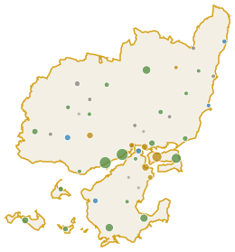
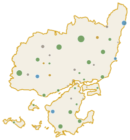
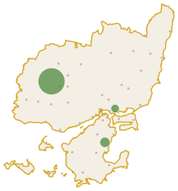
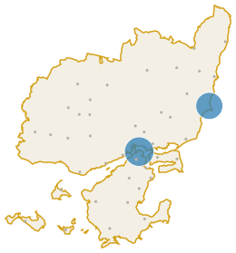
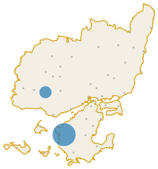
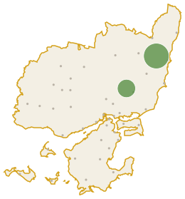
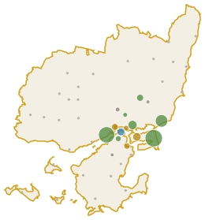
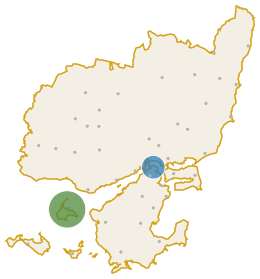
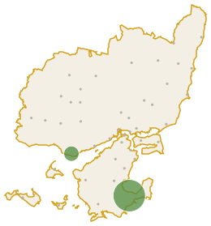
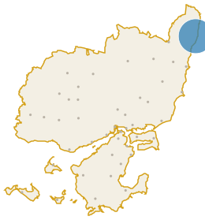

# Creatures

<!-- Generated by `pnpm docs:content` (tools/docs) from the content files. Do not edit by hand. -->

55 creatures in 23 evolution lines: 0 starter lines and 23 wild lines (roster v2, D167). Rarity decides how often a creature appears; the spawn tables follow it (`packages/data/content/svendborg/spawns.json`).

**Chance at its main home** is the share of the creatures in that destination's nature that are this species: what a player standing there sees. Destination creatures (D171) spawn only in their 1–3 home destinations, most at the main home. **Spawn chance** is the share of all wild creatures (no field ability needed) that are this species, computed exactly from the spawn rules over the whole region, day and night counted half each. **Destinations** are real nature (forest, park, meadow, field or water) in the forest, field and lake zones on the Town Map: spawns there are about 2.3 times as dense as in streets and rare creatures 3 times as likely (D167). Common and uncommon creatures appear at the player's own level; rare and very rare ones at their district's level and only once their zone is open.

## Wild lines

| # | Line (evolves at level) | Types | Rarity | Spawn chance in destinations | Spawn chance elsewhere | Chance at its main home | Where | Map |
|---|---|---|---|---|---|---|---|---|
| 1 | Sælkalv → Sundsæl (16) → Havmand (36) | water | Common | – | – | – | districts ; likes . Most in: – | [map](creatures/svb_saelkalv.svg) |
| 2 | Kridtling → Kridtgrævling (16) → Klintkonge (36) | stone | Common | – | – | – | districts ; likes . Most in: – | [map](creatures/svb_kridtling.svg) |
| 3 | Ternling → Havterne (16) → Vejrhane (36) | storm | Common | – | – | – | districts ; likes . Most in: – | [map](creatures/svb_ternling.svg) |
| 4 | Sildeling → Stimsild (18) → Sildekonge (36) | water | Common | 3.3 % | 6.0 % | – | districts 1, 2, 3, 4, 5, 6, 7, 8; likes water, park, urban. Most in: Sankt Jørgens and Kogtved 9 %, Skovsbo and Rantzausminde 9 %, Thurø 7 % | [map](creatures/svb_sildeling.svg) |
| 5 | Havnekat → Skibskat (24) | folk | Common | 0.3 % | 5.2 % | – | districts 1, 2, 3, 4, 5, 6, 7, 8; likes industrial, urban, historic. Most in: Svendborg centre 10 %, Sankt Jørgens and Kogtved 9 %, Tved 7 % | [map](creatures/svb_havnekat.svg) |
| 6 | Egernling → Bøgeegern (14) → Kronegern (32) | grove | Common | 29.1 % | 29.2 % | – | districts 1, 2, 3, 4, 5, 6, 7, 8; likes forest, park, meadow; also with forager. Most in: Gudbjerg woods 15 %, Alminden and Højbjerg 10 %, Kirkeby woods 7 % | [map](creatures/svb_egernling.svg) |
| 7 | Hareling → Markhare (18) → Månehare (36) | folk | Common | 34.6 % | 30.4 % | – | districts 1, 2, 3, 4, 5, 6, 7, 8; likes farmland, meadow, park. Most in: Gudbjerg woods 11 %, Ulbølle 8 %, Alminden and Højbjerg 7 % | [map](creatures/svb_hareling.svg) |
| 8 | Blåmusling → Hestemusling (26) | stone | Common | 2.5 % | 5.4 % | – | districts 1, 2, 3, 4, 5, 6, 7, 8; likes water, industrial, historic. Most in: Sankt Jørgens and Kogtved 9 %, Skovsbo and Rantzausminde 9 %, Thurø 6 % | [map](creatures/svb_blaamusling.svg) |
| 9 | Svampling → Hattesvamp (20) → Heksering (36) | grove | Common | 3.4 % | – | 37.3 % at Svinehaverne woods | **only at Svinehaverne woods (main home), The Kohave woods, Gammel Hestehave woods**; likes forest, meadow, park. Most in: Svinehaverne woods 80 %, The Kohave woods 12 %, Gammel Hestehave woods 8 % | [map](creatures/svb_svampling.svg) |
| 10 | Strandskade → Kystskade (30) | storm | Uncommon | 4.7 % | 5.1 % | – | districts 1, 2, 3, 4, 5, 6, 7, 8; likes water, meadow, farmland. Most in: Gudbjerg woods 10 %, Ulbølle 6 %, Alminden and Højbjerg 6 % | [map](creatures/svb_strandskade.svg) |
| 11 | Ålling → Havål (20) → Ålekonge (38) | water | Uncommon | 1.8 % | 2.5 % | – | districts 1, 2, 3, 4, 5, 6, 7, 8; likes water, meadow. Most in: Skovsbo and Rantzausminde 10 %, Smørmose woods 8 %, Thurø 7 % | [map](creatures/svb_aalling.svg) |
| 12 | Flagling → Aftenbakke (24) | spirit | Uncommon | 2.5 % | 2.6 % | – | districts 1, 2, 3, 4, 5, 6, 7, 8; night; likes historic, park, forest. Most in: Gudbjerg woods 15 %, Alminden and Højbjerg 9 %, Kirkeby woods 9 % | [map](creatures/svb_flagling.svg) |
| 13 | Fyrling → Fyrvogter (18) → Fyrtårn (38) | fire | Uncommon | 0.3 % | 1.7 % | – | districts 1, 2, 3, 4, 5, 6, 7, 8; likes industrial, historic, urban. Most in: Sankt Jørgens and Kogtved 14 %, Svendborg centre 10 %, Tved 8 % | [map](creatures/svb_fyrling.svg) |
| 14 | Søpindling → Søpindsvin (32) | stone | Uncommon | 9.2 % | 8.4 % | – | districts 1, 2, 3, 4, 5, 6, 7, 8; likes farmland, historic, meadow. Most in: Alminden and Højbjerg 12 %, Gudbjerg woods 9 %, Ulbølle 7 % | [map](creatures/svb_soepindling.svg) |
| 15 | Askeling → Bålfugl (28) | fire | Uncommon | 0.7 % | 2.1 % | – | districts 1, 2, 3, 4, 5, 6, 7, 8; likes industrial, urban, park. Most in: Gudbjerg woods 14 %, Klintholm chalk pits 5 %, Hovgård woods 4 % | [map](creatures/svb_askeling.svg) |
| 16 | Brunfiskling → Brunfisk (30) | water | Uncommon | 0.1 % | – | 16.0 % at Vindebyøre beach | **only at Vindebyøre beach (main home), Elsehoved beach**; likes water. Most in: Vindebyøre beach 88 %, Elsehoved beach 12 % | [map](creatures/svb_brunfiskling.svg) |
| 17 | Tågeling → Tågefrue (30) | spirit | Uncommon | 0.9 % | – | 16.1 % at Vejlen marsh | **only at Vejlen marsh (main home), Ollerup lake**; likes meadow, water, farmland. Most in: Vejlen marsh 77 %, Ollerup lake 23 % | [map](creatures/svb_taageling.svg) |
| 18 | Uglunge → Kirkeugle (28) | storm | Uncommon | 0.6 % | – | 14.5 % at Tangeskov and Broholm | **only at Tangeskov and Broholm (main home), Hovgård woods**; night; likes forest, farmland, meadow. Most in: Tangeskov and Broholm 66 %, Hovgård woods 34 % | [map](creatures/svb_uglunge.svg) |
| 19 | Skibsnisse → Klabautermand (34) | folk/water | Rare | <0.1 % | 0.2 % | – | districts 1, 2, 3, 4; likes historic, water, urban; also with runereader. Most in: Sankt Jørgens and Kogtved 27 %, Smørmose woods 17 %, Gammel Hestehave woods 9 % | [map](creatures/svb_skibsnisse.svg) |
| 20 | Guldgubbe → Guldhøvding (38) | stone/spirit | Rare | 5.4 % | 1.3 % | – | districts 5, 6, 7, 8; likes historic, farmland, urban. Most in: Gudbjerg woods 14 %, Ulbølle 11 %, Alminden and Højbjerg 9 % | [map](creatures/svb_guldgubbe.svg) |
| 21 | Havføl → Havhest (38) | water/storm | Rare | 0.1 % | – | 11.5 % at Vindebyøre beach | **only at Vindebyøre beach (main home), Skarø**; likes water; also with angler. Most in: Vindebyøre beach 71 %, Skarø 29 % | [map](creatures/svb_havfoel.svg) |
| 22 | Hyldeknop → Hyldemor (36) | grove/spirit | Rare | 0.4 % | – | 8.5 % at Bjerreby and Tvede woods | **only at Bjerreby and Tvede woods (main home), Lehnskov**; likes forest, park. Most in: Bjerreby and Tvede woods 82 %, Lehnskov 18 % | [map](creatures/svb_hyldeknop.svg) |
| 23 | Mareling → Marmæle (35) | water/folk | Very rare | 0.2 % | – | 3.2 % at Klintholm chalk pits | **only at Klintholm chalk pits (main home)**; likes water. Most in: Klintholm chalk pits 100 % | [map](creatures/svb_maremaeling.svg) |

## Spawn maps

Circles sit on zone centres; their area shows the share of the line's spawns in that zone (green: forest or field, blue: lake, grey: town, gold: arena zone).

<table>
<tr><td align="center"> Sælkalv (common)</td><td align="center"> Kridtling (common)</td><td align="center"> Ternling (common)</td><td align="center"> Sildeling (common)</td></tr>
<tr><td align="center"> Havnekat (common)</td><td align="center"> Egernling (common)</td><td align="center"> Hareling (common)</td><td align="center"> Blåmusling (common)</td></tr>
<tr><td align="center"> Svampling (common)</td><td align="center"> Strandskade (uncommon)</td><td align="center"> Ålling (uncommon)</td><td align="center"> Flagling (uncommon)</td></tr>
<tr><td align="center"> Fyrling (uncommon)</td><td align="center"> Søpindling (uncommon)</td><td align="center"> Askeling (uncommon)</td><td align="center"> Brunfiskling (uncommon)</td></tr>
<tr><td align="center"> Tågeling (uncommon)</td><td align="center"> Uglunge (uncommon)</td><td align="center"> Skibsnisse (rare)</td><td align="center"> Guldgubbe (rare)</td></tr>
<tr><td align="center"> Havføl (rare)</td><td align="center"> Hyldeknop (rare)</td><td align="center"> Mareling (very rare)</td></tr>
</table>

## Starter lines

Chosen at the start; never wild.

| Line (evolves at level) | Types |
|---|---|

## Every creature

| Creature | id | Types | Rarity | Base stats (HP/Atk/Def/Spd = total) | Catch rate | Evolves | Moves learned (level) |
|---|---|---|---|---|---|---|---|
| Sælkalv | `svb_saelkalv` | water | Common | 85/70/80/75 = 310 | 45 | Sundsæl at 16 | Shoulder Shove (1), Sea Fog (1), Brook Spout (5), Nimble Jab (9), Cobble Toss (11), Rinse and Mend (13), Harbour Wave (22), Cobbler Kick (30) |
| Sundsæl | `svb_sundsael` | water | Common | 100/95/95/100 = 390 | 45 | Havmand at 36 | Shoulder Shove (1), Brook Spout (1), Sea Fog (1), Cobble Toss (11), Rinse and Mend (13), Harbour Wave (22), Cobbler Kick (30), Squall Slap (40) |
| Havmand | `svb_havmand` | water/spirit | Common | 100/100/96/104 = 400 | 45 | – | Brook Spout (1), Sea Fog (8), Ripple Dash (16), Grave Chill (18), Rinse and Mend (24), Harbour Wave (30), Hollow Wail (36), Fjord Surge (40) |
| Kridtling | `svb_kridtling` | stone | Common | 80/70/85/55 = 290 | 45 | Kridtgrævling at 16 | Shoulder Shove (1), Stern Glare (1), Grit Spray (5), Cobble Toss (9), Squall Slap (12), Hunker Down (14), Cobbler Kick (20), Boulder Roll (28) |
| Kridtgrævling | `svb_kridtgraevling` | stone | Common | 105/100/110/70 = 385 | 45 | Klintkonge at 36 | Shoulder Shove (1), Cobble Toss (1), Hunker Down (1), Squall Slap (12), Grit Spray (13), Cobbler Kick (20), Boulder Roll (28), Rampart Slam (36) |
| Klintkonge | `svb_klintkonge` | stone/folk | Common | 108/120/112/60 = 400 | 45 | – | Cobble Toss (1), Hunker Down (6), Grit Spray (12), Cobbler Kick (14), Boulder Roll (22), Rampart Slam (32), Market Stampede (36), Rune Slab (40) |
| Ternling | `svb_ternling` | storm | Common | 70/80/55/95 = 300 | 45 | Havterne at 16 | Shoulder Shove (1), Stern Glare (1), Squall Slap (5), Gale Step (9), Brook Spout (12), Prickle Charge (13), Gust Lance (18), Sky Crackle (28) |
| Havterne | `svb_havterne` | storm | Common | 85/105/75/120 = 385 | 45 | Vejrhane at 36 | Shoulder Shove (1), Squall Slap (1), Gale Step (1), Brook Spout (12), Prickle Charge (13), Gust Lance (18), Sky Crackle (28), Cobbler Kick (36) |
| Vejrhane | `svb_vejrhane` | storm/folk | Common | 96/128/84/92 = 400 | 45 | – | Squall Slap (1), Gale Step (8), Cobbler Kick (14), Gust Lance (18), Sky Crackle (26), Market Stampede (36), Thunder Squall (40) |
| Sildeling | `svb_sildeling` | water | Common | 55/68/45/82 = 250 | 255 | Stimsild at 18 | Brook Spout (1), Sea Fog (8), Cobbler Kick (14), Ripple Dash (16), Rinse and Mend (24), Harbour Wave (30), Fjord Surge (40) |
| Stimsild | `svb_stimsild` | water | Common | 73/89/59/109 = 330 | 90 | Sildekonge at 36 | Brook Spout (1), Sea Fog (8), Cobbler Kick (14), Ripple Dash (16), Rinse and Mend (24), Harbour Wave (30), Fjord Surge (40) |
| Sildekonge | `svb_sildekonge` | water/storm | Common | 100/103/96/99 = 398 | 45 | – | Brook Spout (1), Sea Fog (8), Ripple Dash (16), Gust Lance (18), Rinse and Mend (24), Harbour Wave (30), Sky Crackle (36), Fjord Surge (40) |
| Havnekat | `svb_havnekat` | folk | Common | 55/68/45/82 = 250 | 255 | Skibskat at 24 | Shoulder Shove (1), Stern Glare (1), Cobbler Kick (10), Cartwheel (20), Market Stampede (34) |
| Skibskat | `svb_skibskat` | folk/storm | Common | 99/129/91/61 = 380 | 90 | – | Shoulder Shove (1), Stern Glare (1), Cobbler Kick (10), Gust Lance (18), Cartwheel (20), Market Stampede (34), Sky Crackle (36) |
| Egernling | `svb_egernling` | grove | Common | 54/66/44/81 = 245 | 220 | Bøgeegern at 14 | Beech Lash (1), Drowsy Pollen (6), Nettle Sting (12), Cobbler Kick (14), Root Snare (20), Thorn Volley (26), Beech Crown (40) |
| Bøgeegern | `svb_boegeegern` | grove | Common | 73/89/59/109 = 330 | 90 | Kronegern at 32 | Beech Lash (1), Drowsy Pollen (6), Nettle Sting (12), Cobbler Kick (14), Root Snare (20), Thorn Volley (26), Beech Crown (40) |
| Kronegern | `svb_kronegern` | grove/storm | Common | 88/107/72/131 = 398 | 45 | – | Beech Lash (1), Drowsy Pollen (6), Nettle Sting (12), Gust Lance (18), Root Snare (20), Thorn Volley (26), Sky Crackle (36), Beech Crown (40) |
| Hareling | `svb_hareling` | folk | Common | 55/68/45/82 = 250 | 220 | Markhare at 18 | Shoulder Shove (1), Stern Glare (1), Cobbler Kick (10), Cartwheel (20), Market Stampede (34) |
| Markhare | `svb_markhare` | folk | Common | 74/90/60/111 = 335 | 90 | Månehare at 36 | Shoulder Shove (1), Stern Glare (1), Cobbler Kick (10), Cartwheel (20), Market Stampede (34) |
| Månehare | `svb_maanehare` | folk/spirit | Common | 100/103/96/99 = 398 | 45 | – | Shoulder Shove (1), Stern Glare (1), Cobbler Kick (10), Grave Chill (18), Cartwheel (20), Market Stampede (34), Hollow Wail (36) |
| Blåmusling | `svb_blaamusling` | stone | Common | 71/56/84/44 = 255 | 220 | Hestemusling at 26 | Cobble Toss (1), Hunker Down (6), Grit Spray (12), Cobbler Kick (14), Boulder Roll (22), Rampart Slam (32), Rune Slab (40) |
| Hestemusling | `svb_hestemusling` | stone/water | Common | 108/85/127/65 = 385 | 90 | – | Cobble Toss (1), Hunker Down (6), Grit Spray (12), Ripple Dash (18), Boulder Roll (22), Rampart Slam (32), Harbour Wave (36), Rune Slab (40) |
| Svampling | `svb_svampling` | grove | Common | 71/56/84/44 = 255 | 220 | Hattesvamp at 20 | Beech Lash (1), Drowsy Pollen (6), Nettle Sting (12), Cobbler Kick (14), Root Snare (20), Thorn Volley (26), Beech Crown (40) |
| Hattesvamp | `svb_hattesvamp` | grove | Common | 94/74/111/56 = 335 | 90 | Heksering at 36 | Beech Lash (1), Drowsy Pollen (6), Nettle Sting (12), Cobbler Kick (14), Root Snare (20), Thorn Volley (26), Beech Crown (40) |
| Heksering | `svb_heksering` | grove/spirit | Common | 100/103/96/99 = 398 | 45 | – | Beech Lash (1), Drowsy Pollen (6), Nettle Sting (12), Grave Chill (18), Root Snare (20), Thorn Volley (26), Hollow Wail (36), Beech Crown (40) |
| Strandskade | `svb_strandskade` | storm | Uncommon | 66/81/54/99 = 300 | 140 | Kystskade at 30 | Squall Slap (1), Gale Step (8), Cobbler Kick (14), Gust Lance (18), Sky Crackle (26), Thunder Squall (40) |
| Kystskade | `svb_kystskade` | storm/water | Uncommon | 87/107/71/130 = 395 | 60 | – | Squall Slap (1), Gale Step (8), Gust Lance (18), Ripple Dash (18), Sky Crackle (26), Harbour Wave (36), Thunder Squall (40) |
| Ålling | `svb_aalling` | water | Uncommon | 68/70/65/67 = 270 | 140 | Havål at 20 | Brook Spout (1), Sea Fog (8), Cobbler Kick (14), Ripple Dash (16), Rinse and Mend (24), Harbour Wave (30), Fjord Surge (40) |
| Havål | `svb_aal` | water | Uncommon | 88/116/82/54 = 340 | 60 | Ålekonge at 38 | Brook Spout (1), Sea Fog (8), Cobbler Kick (14), Ripple Dash (16), Rinse and Mend (24), Harbour Wave (30), Fjord Surge (40) |
| Ålekonge | `svb_aalekonge` | water/stone | Uncommon | 104/136/96/64 = 400 | 30 | – | Brook Spout (1), Sea Fog (8), Ripple Dash (16), Boulder Roll (18), Rinse and Mend (24), Harbour Wave (30), Rune Slab (36), Fjord Surge (40) |
| Flagling | `svb_flagling` | spirit | Uncommon | 66/81/54/99 = 300 | 140 | Aftenbakke at 24 | Wisp Flicker (1), Moonless Stare (6), Blight Touch (12), Cobbler Kick (14), Grave Chill (18), Hollow Wail (26), Elf Dance (40) |
| Aftenbakke | `svb_aftenbakke` | spirit/folk | Uncommon | 87/107/71/130 = 395 | 60 | – | Wisp Flicker (1), Moonless Stare (6), Blight Touch (12), Cobbler Kick (14), Grave Chill (18), Hollow Wail (26), Market Stampede (36), Elf Dance (40) |
| Fyrling | `svb_fyrling` | fire | Uncommon | 59/73/49/89 = 270 | 140 | Fyrvogter at 18 | Hearth Spark (1), Stoke Up (8), Cobbler Kick (14), Ember Hop (16), Cinder Brand (22), Kiln Blast (30), Forge Flare (40) |
| Fyrvogter | `svb_fyrvogter` | fire | Uncommon | 86/90/83/86 = 345 | 60 | Fyrtårn at 38 | Hearth Spark (1), Stoke Up (8), Cobbler Kick (14), Ember Hop (16), Cinder Brand (22), Kiln Blast (30), Forge Flare (40) |
| Fyrtårn | `svb_fyrtaarn` | fire/stone | Uncommon | 112/88/132/68 = 400 | 30 | – | Hearth Spark (1), Stoke Up (8), Ember Hop (16), Boulder Roll (18), Cinder Brand (22), Kiln Blast (30), Rune Slab (36), Forge Flare (40) |
| Søpindling | `svb_soepindling` | stone | Uncommon | 80/63/94/48 = 285 | 140 | Søpindsvin at 32 | Cobble Toss (1), Hunker Down (6), Grit Spray (12), Cobbler Kick (14), Boulder Roll (22), Rampart Slam (32), Rune Slab (40) |
| Søpindsvin | `svb_soepindsvin` | stone/water | Uncommon | 110/86/129/67 = 392 | 60 | – | Cobble Toss (1), Hunker Down (6), Grit Spray (12), Ripple Dash (18), Boulder Roll (22), Rampart Slam (32), Harbour Wave (36), Rune Slab (40) |
| Askeling | `svb_askeling` | fire | Uncommon | 61/74/50/90 = 275 | 140 | Bålfugl at 28 | Hearth Spark (1), Stoke Up (8), Cobbler Kick (14), Ember Hop (16), Cinder Brand (22), Kiln Blast (30), Forge Flare (40) |
| Bålfugl | `svb_baalfugl` | fire/storm | Uncommon | 85/105/70/128 = 388 | 60 | – | Hearth Spark (1), Stoke Up (8), Ember Hop (16), Gust Lance (18), Cinder Brand (22), Kiln Blast (30), Sky Crackle (36), Forge Flare (40) |
| Brunfiskling | `svb_brunfiskling` | water | Uncommon | 71/74/68/72 = 285 | 140 | Brunfisk at 30 | Brook Spout (1), Sea Fog (8), Cobbler Kick (14), Ripple Dash (16), Rinse and Mend (24), Harbour Wave (30), Fjord Surge (40) |
| Brunfisk | `svb_brunfisk` | water/storm | Uncommon | 86/105/70/129 = 390 | 60 | – | Brook Spout (1), Sea Fog (8), Ripple Dash (16), Gust Lance (18), Rinse and Mend (24), Harbour Wave (30), Sky Crackle (36), Fjord Surge (40) |
| Tågeling | `svb_taageling` | spirit | Uncommon | 70/73/67/70 = 280 | 140 | Tågefrue at 30 | Wisp Flicker (1), Moonless Stare (6), Blight Touch (12), Cobbler Kick (14), Grave Chill (18), Hollow Wail (26), Elf Dance (40) |
| Tågefrue | `svb_taagefrue` | spirit/water | Uncommon | 98/101/94/97 = 390 | 60 | – | Wisp Flicker (1), Moonless Stare (6), Blight Touch (12), Grave Chill (18), Ripple Dash (18), Hollow Wail (26), Harbour Wave (36), Elf Dance (40) |
| Uglunge | `svb_uglunge` | storm | Uncommon | 69/72/66/68 = 275 | 140 | Kirkeugle at 28 | Squall Slap (1), Gale Step (8), Cobbler Kick (14), Gust Lance (18), Sky Crackle (26), Thunder Squall (40) |
| Kirkeugle | `svb_kirkeugle` | storm/spirit | Uncommon | 97/101/93/97 = 388 | 60 | – | Squall Slap (1), Gale Step (8), Gust Lance (18), Grave Chill (18), Sky Crackle (26), Hollow Wail (36), Thunder Squall (40) |
| Skibsnisse | `svb_skibsnisse` | folk/water | Rare | 93/96/89/92 = 370 | 45 | Klabautermand at 34 | Shoulder Shove (1), Stern Glare (1), Cobbler Kick (10), Ripple Dash (18), Cartwheel (20), Market Stampede (34), Harbour Wave (36) |
| Klabautermand | `svb_klabautermand` | folk/water | Rare | 104/136/96/64 = 400 | 25 | – | Shoulder Shove (1), Stern Glare (1), Cobbler Kick (10), Ripple Dash (18), Cartwheel (20), Market Stampede (34), Harbour Wave (36) |
| Guldgubbe | `svb_guldgubbe` | stone/spirit | Rare | 92/73/109/56 = 330 | 45 | Guldhøvding at 38 | Cobble Toss (1), Hunker Down (6), Grit Spray (12), Grave Chill (18), Boulder Roll (22), Rampart Slam (32), Hollow Wail (36), Rune Slab (40) |
| Guldhøvding | `svb_guldhoevding` | stone/spirit | Rare | 112/88/132/68 = 400 | 25 | – | Cobble Toss (1), Hunker Down (6), Grit Spray (12), Grave Chill (18), Boulder Roll (22), Rampart Slam (32), Hollow Wail (36), Rune Slab (40) |
| Havføl | `svb_havfoel` | water/storm | Rare | 81/100/67/122 = 370 | 45 | Havhest at 38 | Brook Spout (1), Sea Fog (8), Ripple Dash (16), Gust Lance (18), Rinse and Mend (24), Harbour Wave (30), Sky Crackle (36), Fjord Surge (40) |
| Havhest | `svb_havhest` | water/storm | Rare | 88/108/72/132 = 400 | 25 | – | Brook Spout (1), Sea Fog (8), Ripple Dash (16), Gust Lance (18), Rinse and Mend (24), Harbour Wave (30), Sky Crackle (36), Fjord Surge (40) |
| Hyldeknop | `svb_hyldeknop` | grove/spirit | Rare | 83/86/79/82 = 330 | 45 | Hyldemor at 36 | Beech Lash (1), Drowsy Pollen (6), Nettle Sting (12), Grave Chill (18), Root Snare (20), Thorn Volley (26), Hollow Wail (36), Beech Crown (40) |
| Hyldemor | `svb_hyldemor` | grove/spirit | Rare | 100/104/96/100 = 400 | 25 | – | Beech Lash (1), Drowsy Pollen (6), Nettle Sting (12), Grave Chill (18), Root Snare (20), Thorn Volley (26), Hollow Wail (36), Beech Crown (40) |
| Mareling | `svb_maremaeling` | water/folk | Very rare | 80/83/77/80 = 320 | 15 | Marmæle at 35 | Brook Spout (1), Sea Fog (8), Cobbler Kick (14), Ripple Dash (16), Rinse and Mend (24), Harbour Wave (30), Market Stampede (36), Fjord Surge (40) |
| Marmæle | `svb_marmaele` | water/folk | Very rare | 100/104/96/100 = 400 | 8 | – | Brook Spout (1), Sea Fog (8), Cobbler Kick (14), Ripple Dash (16), Rinse and Mend (24), Harbour Wave (30), Market Stampede (36), Fjord Surge (40) |

## Spawn tables by district

Weight is the table weight before biome fit; "rare" entries use the district's level band. Destination-only entries never appear outside destinations.

### District 1: Svendborg town (levels 3–8)

| Creature | Weight | Level band | Time | Biomes | Only in destinations | Needs |
|---|---|---|---|---|---|---|
| Havnekat | 25 | player's | any | urban 1, industrial 1.2, historic 1, park 0.3 |  |  |
| Sildeling | 25 | player's | any | water 2, park 0.2, urban 0.2 |  |  |
| Egernling | 25 | player's | any | forest 1.5, park 1, meadow 0.5, farmland 0.4 |  |  |
| Hareling | 25 | player's | any | farmland 1.5, meadow 1, park 0.4, urban 0.2 |  |  |
| Blåmusling | 25 | player's | any | water 1.5, industrial 0.6, historic 0.4, urban 0.3 |  |  |
| Strandskade | 9 | player's | any | water 1, meadow 0.8, farmland 0.4 |  |  |
| Ålling | 9 | player's | any | water 1.5, meadow 0.3 |  |  |
| Flagling | 9 | player's | night | historic 1, park 1, forest 1, water 0.6 |  |  |
| Fyrling | 18 | player's | any | industrial 1.2, historic 1, urban 0.5, water 0.3 |  |  |
| Søpindling | 9 | player's | any | farmland 1, historic 0.8, meadow 0.5, industrial 0.5 |  |  |
| Askeling | 9 | player's | any | industrial 1.2, urban 0.6, park 0.6, meadow 0.3 |  |  |
| Skibsnisse | 2.5 | district | any | historic 2, water 0.5, urban 0.3 |  |  |
| Skibsnisse | 4 | district | any | historic 2, urban 0.2 |  | runereader |
| Egernling | 4 | district | any | forest 2, park 1 |  | forager |

### District 2: Christiansminde and Skårup (levels 8–14)

| Creature | Weight | Level band | Time | Biomes | Only in destinations | Needs |
|---|---|---|---|---|---|---|
| Havnekat | 25 | player's | any | urban 1, industrial 1.2, historic 1, park 0.3 |  |  |
| Sildeling | 25 | player's | any | water 2, park 0.2, urban 0.2 |  |  |
| Egernling | 25 | player's | any | forest 1.5, park 1, meadow 0.5, farmland 0.4 |  |  |
| Hareling | 25 | player's | any | farmland 1.5, meadow 1, park 0.4, urban 0.2 |  |  |
| Blåmusling | 25 | player's | any | water 1.5, industrial 0.6, historic 0.4, urban 0.3 |  |  |
| Strandskade | 9 | player's | any | water 1, meadow 0.8, farmland 0.4 |  |  |
| Ålling | 9 | player's | any | water 1.5, meadow 0.3 |  |  |
| Flagling | 9 | player's | night | historic 1, park 1, forest 1, water 0.6 |  |  |
| Fyrling | 9 | player's | any | industrial 1.2, historic 1, urban 0.5, water 0.3 |  |  |
| Søpindling | 9 | player's | any | farmland 1, historic 0.8, meadow 0.5, industrial 0.5 |  |  |
| Askeling | 18 | player's | any | industrial 1.2, urban 0.6, park 0.6, meadow 0.3 |  |  |
| Skibsnisse | 2.5 | district | any | historic 2, water 0.5, urban 0.3 |  |  |
| Svampling | 15 | player's | any | forest 1.5, meadow 0.6, park 0.5 | yes |  |
| Uglunge | 8 | player's | night | forest 1.5, farmland 0.6, meadow 0.5 | yes |  |

### District 3: Thurø and Åbyskov (levels 13–20)

| Creature | Weight | Level band | Time | Biomes | Only in destinations | Needs |
|---|---|---|---|---|---|---|
| Havnekat | 25 | player's | any | urban 1, industrial 1.2, historic 1, park 0.3 |  |  |
| Sildeling | 25 | player's | any | water 2, park 0.2, urban 0.2 |  |  |
| Egernling | 25 | player's | any | forest 1.5, park 1, meadow 0.5, farmland 0.4 |  |  |
| Hareling | 25 | player's | any | farmland 1.5, meadow 1, park 0.4, urban 0.2 |  |  |
| Blåmusling | 25 | player's | any | water 1.5, industrial 0.6, historic 0.4, urban 0.3 |  |  |
| Strandskade | 9 | player's | any | water 1, meadow 0.8, farmland 0.4 |  |  |
| Ålling | 18 | player's | any | water 1.5, meadow 0.3 |  |  |
| Flagling | 9 | player's | night | historic 1, park 1, forest 1, water 0.6 |  |  |
| Fyrling | 9 | player's | any | industrial 1.2, historic 1, urban 0.5, water 0.3 |  |  |
| Søpindling | 9 | player's | any | farmland 1, historic 0.8, meadow 0.5, industrial 0.5 |  |  |
| Askeling | 9 | player's | any | industrial 1.2, urban 0.6, park 0.6, meadow 0.3 |  |  |
| Skibsnisse | 2.5 | district | any | historic 2, water 0.5, urban 0.3 |  |  |

### District 4: Troense and north Tåsinge (levels 19–26)

| Creature | Weight | Level band | Time | Biomes | Only in destinations | Needs |
|---|---|---|---|---|---|---|
| Havnekat | 25 | player's | any | urban 1, industrial 1.2, historic 1, park 0.3 |  |  |
| Sildeling | 25 | player's | any | water 2, park 0.2, urban 0.2 |  |  |
| Egernling | 25 | player's | any | forest 1.5, park 1, meadow 0.5, farmland 0.4 |  |  |
| Hareling | 25 | player's | any | farmland 1.5, meadow 1, park 0.4, urban 0.2 |  |  |
| Blåmusling | 25 | player's | any | water 1.5, industrial 0.6, historic 0.4, urban 0.3 |  |  |
| Strandskade | 18 | player's | any | water 1, meadow 0.8, farmland 0.4 |  |  |
| Ålling | 9 | player's | any | water 1.5, meadow 0.3 |  |  |
| Flagling | 9 | player's | night | historic 1, park 1, forest 1, water 0.6 |  |  |
| Fyrling | 9 | player's | any | industrial 1.2, historic 1, urban 0.5, water 0.3 |  |  |
| Søpindling | 9 | player's | any | farmland 1, historic 0.8, meadow 0.5, industrial 0.5 |  |  |
| Askeling | 9 | player's | any | industrial 1.2, urban 0.6, park 0.6, meadow 0.3 |  |  |
| Skibsnisse | 2.5 | district | any | historic 2, water 0.5, urban 0.3 |  |  |
| Brunfiskling | 25 | player's | any | water 2 | yes |  |
| Havføl | 6 | district | any | water 2 | yes |  |
| Havføl | 4 | district | any | water 2 | yes | angler |

### District 5: Valdemars Slot and south Tåsinge (levels 25–32)

| Creature | Weight | Level band | Time | Biomes | Only in destinations | Needs |
|---|---|---|---|---|---|---|
| Havnekat | 25 | player's | any | urban 1, industrial 1.2, historic 1, park 0.3 |  |  |
| Sildeling | 25 | player's | any | water 2, park 0.2, urban 0.2 |  |  |
| Egernling | 25 | player's | any | forest 1.5, park 1, meadow 0.5, farmland 0.4 |  |  |
| Hareling | 25 | player's | any | farmland 1.5, meadow 1, park 0.4, urban 0.2 |  |  |
| Blåmusling | 25 | player's | any | water 1.5, industrial 0.6, historic 0.4, urban 0.3 |  |  |
| Strandskade | 9 | player's | any | water 1, meadow 0.8, farmland 0.4 |  |  |
| Ålling | 9 | player's | any | water 1.5, meadow 0.3 |  |  |
| Flagling | 18 | player's | night | historic 1, park 1, forest 1, water 0.6 |  |  |
| Fyrling | 9 | player's | any | industrial 1.2, historic 1, urban 0.5, water 0.3 |  |  |
| Søpindling | 9 | player's | any | farmland 1, historic 0.8, meadow 0.5, industrial 0.5 |  |  |
| Askeling | 9 | player's | any | industrial 1.2, urban 0.6, park 0.6, meadow 0.3 |  |  |
| Guldgubbe | 2.5 | district | any | historic 1.5, farmland 1, urban 0.3 |  |  |
| Svampling | 12 | player's | any | forest 1.5, meadow 0.6, park 0.5 | yes |  |
| Tågeling | 30 | player's | any | water 1, meadow 1.5, farmland 0.5 | yes |  |
| Hyldeknop | 4 | district | any | forest 2, park 0.5 | yes |  |

### District 6: The Egebjerg hills (levels 31–38)

| Creature | Weight | Level band | Time | Biomes | Only in destinations | Needs |
|---|---|---|---|---|---|---|
| Havnekat | 25 | player's | any | urban 1, industrial 1.2, historic 1, park 0.3 |  |  |
| Sildeling | 25 | player's | any | water 2, park 0.2, urban 0.2 |  |  |
| Egernling | 25 | player's | any | forest 1.5, park 1, meadow 0.5, farmland 0.4 |  |  |
| Hareling | 25 | player's | any | farmland 1.5, meadow 1, park 0.4, urban 0.2 |  |  |
| Blåmusling | 25 | player's | any | water 1.5, industrial 0.6, historic 0.4, urban 0.3 |  |  |
| Strandskade | 9 | player's | any | water 1, meadow 0.8, farmland 0.4 |  |  |
| Ålling | 9 | player's | any | water 1.5, meadow 0.3 |  |  |
| Flagling | 9 | player's | night | historic 1, park 1, forest 1, water 0.6 |  |  |
| Fyrling | 9 | player's | any | industrial 1.2, historic 1, urban 0.5, water 0.3 |  |  |
| Søpindling | 18 | player's | any | farmland 1, historic 0.8, meadow 0.5, industrial 0.5 |  |  |
| Askeling | 9 | player's | any | industrial 1.2, urban 0.6, park 0.6, meadow 0.3 |  |  |
| Guldgubbe | 2.5 | district | any | historic 1.5, farmland 1, urban 0.3 |  |  |
| Svampling | 60 | player's | any | forest 1.5, meadow 0.6, park 0.5 | yes |  |

### District 7: Hvidkilde and the islands (levels 37–44)

| Creature | Weight | Level band | Time | Biomes | Only in destinations | Needs |
|---|---|---|---|---|---|---|
| Havnekat | 25 | player's | any | urban 1, industrial 1.2, historic 1, park 0.3 |  |  |
| Sildeling | 25 | player's | any | water 2, park 0.2, urban 0.2 |  |  |
| Egernling | 25 | player's | any | forest 1.5, park 1, meadow 0.5, farmland 0.4 |  |  |
| Hareling | 25 | player's | any | farmland 1.5, meadow 1, park 0.4, urban 0.2 |  |  |
| Blåmusling | 25 | player's | any | water 1.5, industrial 0.6, historic 0.4, urban 0.3 |  |  |
| Strandskade | 9 | player's | any | water 1, meadow 0.8, farmland 0.4 |  |  |
| Ålling | 18 | player's | any | water 1.5, meadow 0.3 |  |  |
| Flagling | 9 | player's | night | historic 1, park 1, forest 1, water 0.6 |  |  |
| Fyrling | 9 | player's | any | industrial 1.2, historic 1, urban 0.5, water 0.3 |  |  |
| Søpindling | 9 | player's | any | farmland 1, historic 0.8, meadow 0.5, industrial 0.5 |  |  |
| Askeling | 9 | player's | any | industrial 1.2, urban 0.6, park 0.6, meadow 0.3 |  |  |
| Guldgubbe | 2.5 | district | any | historic 1.5, farmland 1, urban 0.3 |  |  |
| Tågeling | 8 | player's | any | water 1, meadow 1.5, farmland 0.5 | yes |  |
| Havføl | 3 | district | any | water 2 | yes |  |
| Hyldeknop | 2 | district | any | forest 2, park 0.5 | yes |  |

### District 8: Gudme and Lundeborg (levels 43–50)

| Creature | Weight | Level band | Time | Biomes | Only in destinations | Needs |
|---|---|---|---|---|---|---|
| Havnekat | 25 | player's | any | urban 1, industrial 1.2, historic 1, park 0.3 |  |  |
| Sildeling | 25 | player's | any | water 2, park 0.2, urban 0.2 |  |  |
| Egernling | 25 | player's | any | forest 1.5, park 1, meadow 0.5, farmland 0.4 |  |  |
| Hareling | 25 | player's | any | farmland 1.5, meadow 1, park 0.4, urban 0.2 |  |  |
| Blåmusling | 25 | player's | any | water 1.5, industrial 0.6, historic 0.4, urban 0.3 |  |  |
| Strandskade | 9 | player's | any | water 1, meadow 0.8, farmland 0.4 |  |  |
| Ålling | 9 | player's | any | water 1.5, meadow 0.3 |  |  |
| Flagling | 9 | player's | night | historic 1, park 1, forest 1, water 0.6 |  |  |
| Fyrling | 9 | player's | any | industrial 1.2, historic 1, urban 0.5, water 0.3 |  |  |
| Søpindling | 9 | player's | any | farmland 1, historic 0.8, meadow 0.5, industrial 0.5 |  |  |
| Askeling | 18 | player's | any | industrial 1.2, urban 0.6, park 0.6, meadow 0.3 |  |  |
| Guldgubbe | 2.5 | district | any | historic 1.5, farmland 1, urban 0.3 |  |  |
| Brunfiskling | 8 | player's | any | water 2 | yes |  |
| Uglunge | 30 | player's | night | forest 1.5, farmland 0.6, meadow 0.5 | yes |  |
| Mareling | 18 | district | any | water 2 | yes |  |
