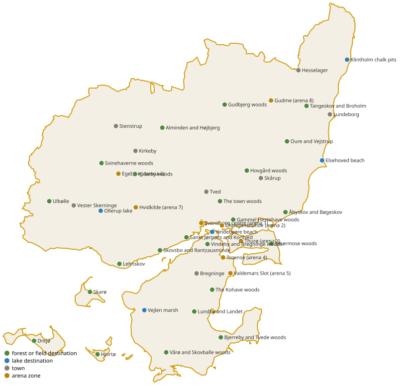

# Creatures

<!-- Generated by `pnpm docs:content` (tools/docs) from the content files. Do not edit by hand. -->

0 creatures in 0 evolution lines: 0 starter lines and 0 wild lines (roster v2, D167). Rarity decides how often a creature appears; the spawn tables follow it (`packages/data/content/svendborg/spawns.json`).

**Chance at its main home** is the share of the creatures in that destination's nature that are this species: what a player standing there sees. Destination creatures (D171) spawn only in their 1–3 home destinations, most at the main home. **Spawn chance** is the share of all wild creatures (no field ability needed) that are this species, computed exactly from the spawn rules over the whole region, day and night counted half each. **Destinations** are real nature (forest, park, meadow, field or water) in the forest, field and lake zones on the Town Map: spawns there are about 2.3 times as dense as in streets and rare creatures 3 times as likely (D167). Common and uncommon creatures appear at the player's own level; rare and very rare ones at their district's level and only once their zone is open.

## Wild lines

| # | Line (evolves at level) | Types | Rarity | Spawn chance in destinations | Spawn chance elsewhere | Chance at its main home | Where | Map |
|---|---|---|---|---|---|---|---|---|

## Spawn maps

Circles sit on zone centres; their area shows the share of the line's spawns in that zone (green: forest or field, blue: lake, grey: town, gold: arena zone).

<table>
</table>

## Starter lines

Chosen at the start; never wild.

| Line (evolves at level) | Types |
|---|---|

## Every creature

| Creature | id | Types | Rarity | Base stats (HP/Atk/Def/Spd = total) | Catch rate | Evolves | Moves learned (level) |
|---|---|---|---|---|---|---|---|

## Spawn tables by district

Weight is the table weight before biome fit; "rare" entries use the district's level band. Destination-only entries never appear outside destinations.

### District 1: Svendborg town (levels 3–8)

| Creature | Weight | Level band | Time | Biomes | Only in destinations | Needs |
|---|---|---|---|---|---|---|

### District 2: Christiansminde and Skårup (levels 8–14)

| Creature | Weight | Level band | Time | Biomes | Only in destinations | Needs |
|---|---|---|---|---|---|---|

### District 3: Thurø and Åbyskov (levels 13–20)

| Creature | Weight | Level band | Time | Biomes | Only in destinations | Needs |
|---|---|---|---|---|---|---|

### District 4: Troense and north Tåsinge (levels 19–26)

| Creature | Weight | Level band | Time | Biomes | Only in destinations | Needs |
|---|---|---|---|---|---|---|

### District 5: Valdemars Slot and south Tåsinge (levels 25–32)

| Creature | Weight | Level band | Time | Biomes | Only in destinations | Needs |
|---|---|---|---|---|---|---|

### District 6: The Egebjerg hills (levels 31–38)

| Creature | Weight | Level band | Time | Biomes | Only in destinations | Needs |
|---|---|---|---|---|---|---|

### District 7: Hvidkilde and the islands (levels 37–44)

| Creature | Weight | Level band | Time | Biomes | Only in destinations | Needs |
|---|---|---|---|---|---|---|

### District 8: Gudme and Lundeborg (levels 43–50)

| Creature | Weight | Level band | Time | Biomes | Only in destinations | Needs |
|---|---|---|---|---|---|---|
