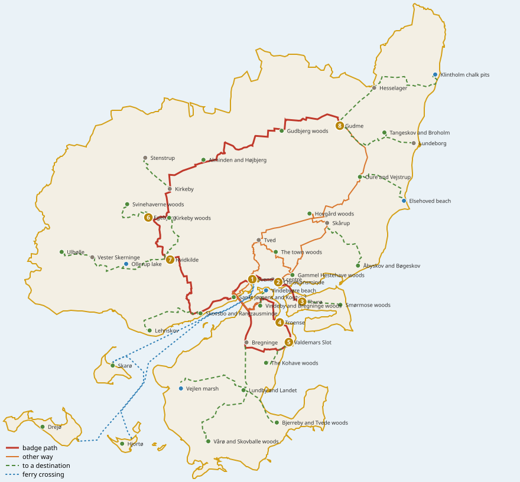

# Svendborg

<!-- Generated by `pnpm docs:content` (tools/docs) from the content files. Do not edit by hand. -->

Region `svendborg`: 44 zones in 8 districts, 45 walking routes (165.1 km), 3 ferry crossings, 8 arenas, 55 creatures, 118 trainers. State and features: [REGIONS.md](../../REGIONS.md).

## Arenas

| # | Site | Zone | Theme | Badge |
| --- | --- | --- | --- | --- |
| 1 | The old harbour (Frederiksø) | Svendborg centre | spirit | Lantern badge |
| 2 | Christiansminde | Christiansminde | fire | Bonfire badge |
| 3 | Thurø | Thurø | water | Island badge |
| 4 | Troense | Troense | storm | Skipper badge |
| 5 | Valdemars Slot | Valdemars Slot | folk | Castle badge |
| 6 | Egebjerg mill | Egebjerg | stone | Mill badge |
| 7 | Hvidkilde | Hvidkilde | grove | Forest badge |
| 8 | Gudme | Gudme | mixed | Gold badge |

## Zones

| Zone | id | Kind | District | Notes |
| --- | --- | --- | --- | --- |
| The town woods | `svb_byskovene` | wild (forest) | 1 |  |
| Svendborg centre | `svb_centrum` | arena | 1 | start, arena 1 |
| Sankt Jørgens and Kogtved | `svb_sanktjoergens` | wild (field) | 1 |  |
| Tved | `svb_tved` | town (town) | 1 |  |
| Christiansminde | `svb_christiansminde` | arena | 2 | arena 2 |
| Gammel Hestehave woods | `svb_hestehaven` | wild (forest) | 2 |  |
| Hovgård woods | `svb_hovgaard` | wild (forest) | 2 |  |
| Skårup | `svb_skaarup` | town (town) | 2 |  |
| Åbyskov and Bøgeskov | `svb_aabyskov` | wild (forest) | 3 |  |
| Smørmose woods | `svb_smoermose` | wild (forest) | 3 |  |
| Thurø | `svb_thuroe` | arena | 3 | arena 3 |
| Bregninge | `svb_bregninge` | town (town) | 4 |  |
| Troense | `svb_troense` | arena | 4 | arena 4 |
| Vindeby and Bregninge woods | `svb_vindeby` | wild (forest) | 4 |  |
| Vindebyøre beach | `svb_vindebyoere` | water (lake) | 4 |  |
| Bjerreby and Tvede woods | `svb_bjerreby` | wild (forest) | 5 |  |
| The Kohave woods | `svb_kohaverne` | wild (forest) | 5 |  |
| Lundby and Landet | `svb_lundby` | wild (field) | 5 |  |
| Vårø and Skovballe woods | `svb_vaaroe` | wild (forest) | 5 |  |
| Valdemars Slot | `svb_valdemars` | arena | 5 | arena 5 |
| Vejlen marsh | `svb_vejlen` | water (lake) | 5 |  |
| Alminden and Højbjerg | `svb_alminden` | wild (forest) | 6 |  |
| Egebjerg | `svb_egebjerg` | arena | 6 | arena 6 |
| Kirkeby | `svb_kirkeby` | town (town) | 6 |  |
| Kirkeby woods | `svb_kirkebyskov` | wild (forest) | 6 |  |
| Stenstrup | `svb_stenstrup` | town (town) | 6 |  |
| Svinehaverne woods | `svb_svinehaverne` | wild (forest) | 6 |  |
| Drejø | `svb_drejoe` | wild (island) | 7 | ferry island: opens on arrival |
| Hjortø | `svb_hjortoe` | wild (island) | 7 | ferry island: opens on arrival |
| Hvidkilde | `svb_hvidkilde` | arena | 7 | arena 7 |
| Lehnskov | `svb_lehnskov` | wild (forest) | 7 |  |
| Ollerup lake | `svb_ollerupsoe` | water (lake) | 7 |  |
| Skarø | `svb_skaroe` | wild (island) | 7 | ferry island: opens on arrival |
| Skovsbo and Rantzausminde | `svb_skovsbo` | wild (forest) | 7 |  |
| Ulbølle | `svb_ulboelle` | wild (field) | 7 |  |
| Vester Skerninge | `svb_vesterskerninge` | town (town) | 7 |  |
| Elsehoved beach | `svb_elsehoved` | water (lake) | 8 |  |
| Gudbjerg woods | `svb_gudbjerg` | wild (forest) | 8 |  |
| Gudme | `svb_gudme` | arena | 8 | arena 8 |
| Hesselager | `svb_hesselager` | town (town) | 8 |  |
| Klintholm chalk pits | `svb_klintholm` | water (lake) | 8 |  |
| Lundeborg | `svb_lundeborg` | town (town) | 8 |  |
| Oure and Vejstrup | `svb_oure` | wild (field) | 8 |  |
| Tangeskov and Broholm | `svb_tangeskov` | wild (forest) | 8 |  |

## Routes

| # | From | To | Kind | Length | Wild |
| --- | --- | --- | --- | --- | --- |
| 1 | Svendborg centre | Christiansminde | main | 2.4 km | 59 % |
| 2 | Christiansminde | Thurø | main | 2.5 km | 41 % |
| 3 | Svendborg centre | Vindeby and Bregninge woods | main | 4.4 km | 32 % |
| 4 | Vindeby and Bregninge woods | Troense | main | 2.8 km | 50 % |
| 5 | Troense | Valdemars Slot | main | 1.8 km | 17 % |
| 6 | Valdemars Slot | Bregninge | main | 4.3 km | 40 % |
| 7 | Bregninge | Sankt Jørgens and Kogtved | main | 4.3 km | 44 % |
| 8 | Sankt Jørgens and Kogtved | Skovsbo and Rantzausminde | main | 2.8 km | 18 % |
| 9 | Skovsbo and Rantzausminde | Hvidkilde | main | 5.9 km | 19 % |
| 10 | Hvidkilde | Egebjerg | main | 4.2 km | 70 % |
| 11 | Egebjerg | Kirkeby | main | 3.4 km | 57 % |
| 12 | Kirkeby | Alminden and Højbjerg | main | 3.6 km | 11 % |
| 13 | Alminden and Højbjerg | Gudbjerg woods | main | 7.9 km | 35 % |
| 14 | Gudbjerg woods | Gudme | main | 5.0 km | 17 % |
| 15 | Svendborg centre | Tved | alt | 3.7 km | 28 % |
| 16 | Tved | The town woods | alt | 1.9 km | 21 % |
| 17 | The town woods | Gammel Hestehave woods | alt | 2.6 km | 38 % |
| 18 | Gammel Hestehave woods | Christiansminde | alt | 1.4 km | 100 % |
| 19 | Svendborg centre | Sankt Jørgens and Kogtved | alt | 1.9 km | 8 % |
| 20 | Sankt Jørgens and Kogtved | Vindeby and Bregninge woods | alt | 3.1 km | 48 % |
| 21 | Vindeby and Bregninge woods | Vindebyøre beach | explore | 1.2 km | 24 % |
| 22 | Gammel Hestehave woods | Skårup | alt | 5.0 km | 28 % |
| 23 | Skårup | Hovgård woods | alt | 1.8 km | 47 % |
| 24 | Hovgård woods | Oure and Vejstrup | alt | 5.4 km | 11 % |
| 25 | Oure and Vejstrup | Gudme | alt | 4.6 km | 5 % |
| 26 | Thurø | Smørmose woods | explore | 2.5 km | 7 % |
| 27 | Skårup | Åbyskov and Bøgeskov | explore | 4.5 km | 8 % |
| 28 | Tved | Hovgård woods | alt | 4.6 km | 10 % |
| 29 | Valdemars Slot | The Kohave woods | explore | 2.9 km | 79 % |
| 30 | Bregninge | Lundby and Landet | explore | 3.3 km | 25 % |
| 31 | Lundby and Landet | Bjerreby and Tvede woods | explore | 3.0 km | 7 % |
| 32 | Lundby and Landet | Vårø and Skovballe woods | explore | 5.8 km | 1 % |
| 33 | Lundby and Landet | Vejlen marsh | explore | 5.1 km | 10 % |
| 34 | Egebjerg | Svinehaverne woods | explore | 3.4 km | 63 % |
| 35 | Hvidkilde | Kirkeby woods | explore | 4.3 km | 88 % |
| 36 | Hvidkilde | Ollerup lake | explore | 3.7 km | 13 % |
| 37 | Ollerup lake | Vester Skerninge | explore | 3.3 km | 9 % |
| 38 | Vester Skerninge | Ulbølle | explore | 2.4 km | 0 % |
| 39 | Skovsbo and Rantzausminde | Lehnskov | explore | 5.0 km | 31 % |
| 40 | Kirkeby | Stenstrup | explore | 3.0 km | 3 % |
| 41 | Gudme | Tangeskov and Broholm | explore | 4.4 km | 14 % |
| 42 | Tangeskov and Broholm | Lundeborg | explore | 2.2 km | 32 % |
| 43 | Gudme | Hesselager | explore | 3.4 km | 3 % |
| 44 | Hesselager | Klintholm chalk pits | explore | 5.9 km | 12 % |
| 45 | Oure and Vejstrup | Elsehoved beach | explore | 4.3 km | 10 % |
| 46 | Svendborg centre | Skarø | ferry | 11.1 km | – |
| 47 | Skarø | Drejø | ferry | 9.2 km | – |
| 48 | Svendborg centre | Hjortø | ferry | 14.6 km | – |
